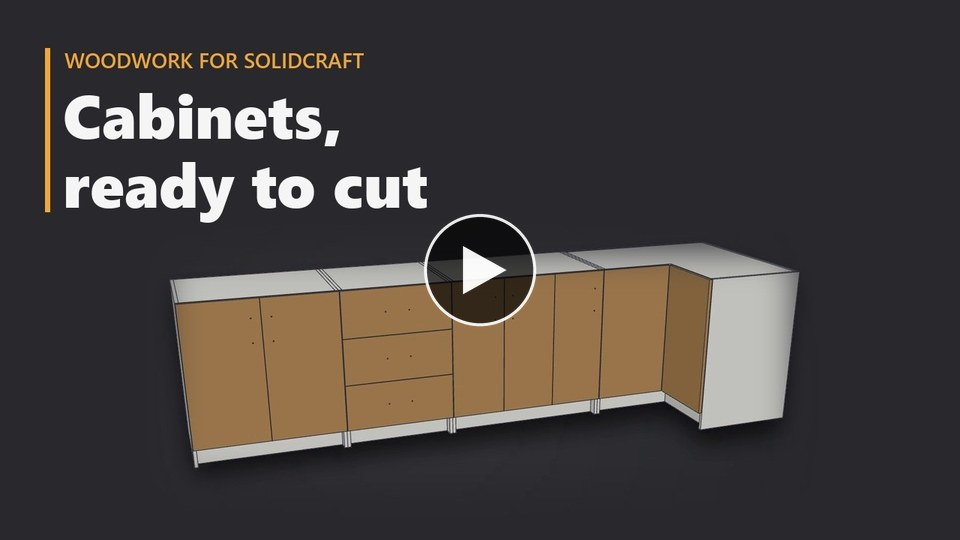

# solidcraft-woodwork

Woodworking plugin for SolidCraft: parametric cabinets, materials, joinery and a cut list.
Works with SolidCraft 0.46; older plugin versions work with 0.41 to 0.45. See [PLAN.md](PLAN.md) for the roadmap.

The picture opens a one minute introduction on YouTube. Three how-tos follow it in the
[Woodwork for SolidCraft playlist](https://www.youtube.com/playlist?list=PLCpxga1LxgoA).

## Functions

Under **Plugins > Woodwork**, and as buttons on the ribbon:

- **Cabinet**: a box carcass with shelves, dividers, back and plinth; doors, drawers, or
  drawers above or below doors, that open on their joints, overlay or inset; shelf pin and handle holes. Also as a sink base
  (rails instead of a top).
- **Corner cabinet**: L-shaped with a bi-fold pair of doors, or diagonal with one door.
- **Place**, in both: a new cabinet goes against the one you selected and is held to it, so
  a run stays together when a cabinet changes size.
- **Edit cabinet**: change shelves, doors, drawers and more on a cabinet that is already made.
- **Joinery**: confirmat screw or dowel holes at the carcass corners.
- **Material**: birch plywood, MDF, white melamine or oak, for a cabinet or just its doors.
- **Panel**: an end panel or a filler on one end of a cabinet, following its sizes.
- **Drawing**: a shop drawing sheet per cabinet, A3, with front, right and iso views, its width, height and depth, and its boards.
- **Cut list**: every board with its size and quantity, hardware, edge banding per edge and grain direction, and the sheets to buy from cutting layouts (kerf, trim, grain), as CSV or a printable PDF with a cutting diagram per sheet, part labels to print on A4 sticker sheets, and a DXF per sheet with the parts and their holes for a CNC.

Every size is a design parameter: change one and the cabinet follows.

**[How to use each function](docs/usage.md)**

## Install

1. Download `woodwork-<version>.zip` from the [latest release](../../releases/latest)
   (under **Assets**, not the source code zip).
   To try new functions early, take the newest release candidate (marked Pre-release) from
   the [releases page](../../releases) instead. It may still change before the full release.
2. In SolidCraft open **Preferences > Plugins** and choose **Install plugin...**

The functions then appear under **Plugins > Woodwork**.

## SolidCraft versions

| SolidCraft | Plugin | Notes |
|---|---|---|
| 0.46 | next version | The dialogs show only the fields that apply: fields hide when they don't apply to the choices made. |
| 0.45 | 0.2.0 | Tested on every change, on 0.45.0. The view is framed after a cabinet is added, a placed cabinet is previewed where it goes, and agents get each function as a tool. |
| 0.44 | 0.1.8 | A cabinet is previewed in the model before it is added, the selection is a field in the dialog, and each function has its own icon. The preview of a placed cabinet can show on the origin. |
| 0.43 | 0.1.6 and 0.1.7 | The dropdowns show a title and an explanation for each choice, and installing asks you to approve the plugin. |
| 0.42 | 0.1.4 and 0.1.5 | Adds a button per function on the ribbon. From 0.1.6 the functions no longer show in its menu. |
| 0.41 | 0.1.0 to 0.1.5 | The first version with plugins. 0.1.0 to 0.1.3 were tested on it; 0.1.4 and 0.1.5 should work but were not tested there. |
| 0.40 and earlier | none | No plugin support. |

A design made with the plugin is ordinary bodies, joints and parameters: it opens in any
SolidCraft from 0.41 on, with or without the plugin.

## Build from source

Needs Rust with the `wasm32-unknown-unknown` target, `wasm-tools` and Python.

    python build.py            # test, build, package, end-to-end test
    python build.py --install  # also install into SolidCraft

The package lands in `dist/woodwork-<version>.zip`. It can also be installed from
Preferences > Plugins > Install plugin

## Example

The kitchen in the picture is in the repo:

- [`examples/kitchen.sc`](examples/kitchen.sc): the design. Open it in SolidCraft; it needs no plugin.
- [`examples/kitchen-cutlist.csv`](examples/kitchen-cutlist.csv): its cut list, 125 boards.
- [`examples/kitchen.py`](examples/kitchen.py): the script that built both, using every function of
  the plugin: an L-shaped kitchen with corner cabinets, cabinets placed against each other and
  linked in size (change `Base_1_height` and the whole floor run follows), an L-shaped and a
  diagonal corner cabinet, a sink base, an inset door, handle holes,
  melamine carcasses with oak fronts, end panels, screws and dowels, a shelf added with Edit cabinet, a shop
  drawing of every cabinet, doors and a drawer left open on their joints.

To rebuild it, run `python build.py` and then `python examples/kitchen.py`.

## Licence

MIT, see [LICENSE](LICENSE). `wit/plugin.wit` is SolidCraft's plugin interface, from
[tangency-labs/solidcraft](https://github.com/tangency-labs/solidcraft) (MIT OR Apache-2.0).

## Layout

- `plugin.json`: manifest. Entries, their input forms, and the app commands used.
- `src/lib.rs`: entry dispatch and the wasm guest.
- `src/cabinet/`, `src/corner/`, `src/edit/`, `src/joinery/`, `src/panel/`, `src/material.rs`, `src/cutlist/`,
  `src/drawing/`: one module per function, plain Rust. The cut list's files are written by
  `src/pdf/` and `src/dxf/`, its cutting layouts by `src/nesting/`. A folder holds the code in `mod.rs` (the box cabinet also has
  `input.rs`, `doors.rs` and `drawers.rs`, the corner cabinet `input.rs`, `doors.rs` and `diagonal.rs`) and its unit tests
  in `tests.rs`.
- `src/kit/` and `src/fittings.rs`: what the two cabinet builders share, the panels and
  parameters, and the hardware (shelf pins, hinge cups, handles).
- `src/select/`: finds the cabinet that is selected.
- `build.py`: build, package and end-to-end test through `solidcraft-cli`.
- `tests/`: the end-to-end tests, one file per function. Unit tests are in `tests.rs` beside
  each module in `src/`.
