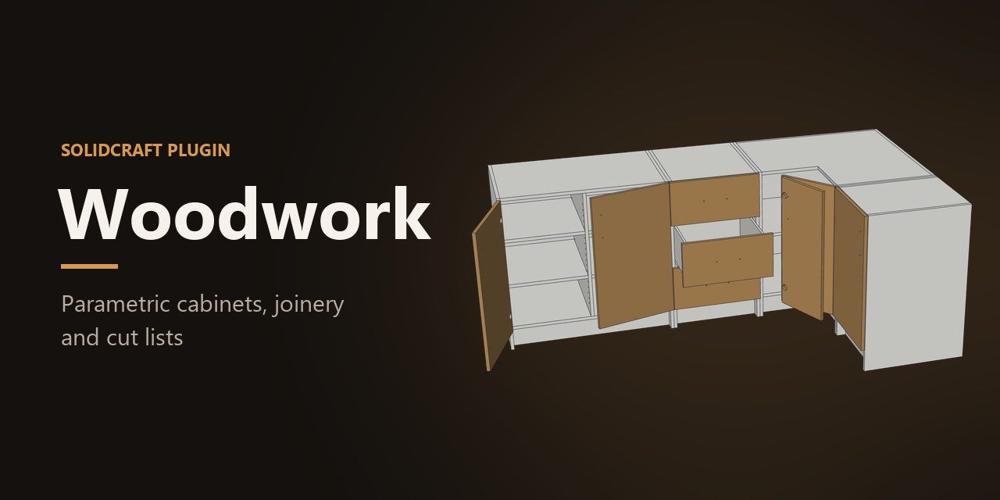

# solidcraft-woodwork

Woodworking plugin for SolidCraft: parametric cabinets, materials, joinery and a cut list.
Works with SolidCraft 0.43; older plugin versions work with 0.41 and 0.42. See [PLAN.md](PLAN.md) for the roadmap.

The picture opens a one minute introduction on YouTube. Three how-tos follow it in the
[Woodwork for SolidCraft playlist](https://www.youtube.com/playlist?list=PLCpxga1LxgoA).

## Functions

Under **Plugins > Woodwork**, and as buttons on the ribbon:

- **Cabinet** builds a box carcass: sides, top, bottom, shelves, back and optional plinth.
  Vertical dividers split it into equal compartments, each with the same shelves.
  Options: back in a groove or overlaid, 32 mm shelf pin holes, overlay doors with hinge cup
  holes (one, two, or one per compartment). **First door hinged** sets the side the first
  door is hinged on, left or right; the next ones alternate, and two doors always open from
  the middle. Each panel is an ordinary named body.
  The cabinet stands on Z = 0, centred on the origin.
  - It is a component of its own, inside whichever component is active, so it moves as one
    piece and a room component can hold its cabinets.
  - **Drawers** makes it a drawer unit: a stack of equal drawers with overlay fronts and
    boxes sized for 12.7 mm ball-bearing slides.
  - **Handle holes** drills the doors and drawer fronts for a knob (one 5 mm hole) or a
    pull (two, 128 mm apart). **Handle position** puts a door's handle near the top, in the
    middle or near the bottom; left on auto it is near the top on a floor unit and near the
    bottom on a wall unit. On a drawer front the handle lies across: in the middle on auto, or 40 mm from
    the front's top or bottom edge.
  - **Labels** writes each board's name on it, the name the cut list has, as text in a
    sketch on the board's face. It stays in the middle of the board when the cabinet
    changes size.
  - Every door and every drawer is a component of its own inside the cabinet, held by a
    joint: doors hinge open to 110 degrees, drawers slide out. Drive the joints to open them.
    A door turns about its front edge, as on a cup hinge, so it clears the door of the next
    cabinet.
    The cabinet is grounded so they have something fixed to open against; unground it to
    move it. A cabinet placed against another is held to that one instead, see Place.
  - **Place** puts it against the cabinet you have selected (any part of it): to the right,
    to the left, or on top, backs flush. That cabinet must stand square to the axes.
    Right is against that cabinet's right side and left against its left side, whichever
    way it stands: on the return's side of a corner cabinet the new one is turned a quarter
    and continues along the return, and the run carries on from there, corner cabinets too.
    The new cabinet is held to that one by a joint (`Name link`), so a run stays together:
    make a cabinet wider and the ones placed after it move along; make one higher and the
    one on top of it rises. A cabinet stands on its own middle, so the first of a run grows
    to both sides. Only the distance follows: a cabinet made deeper afterwards is not moved
    back to keep the backs flush, and a cabinet at the end of a corner cabinet's return does
    not move sideways when the corner cabinet gets wider. To move a cabinet out of a run,
    delete its link.
  - Its sizes are design parameters (`Name_width`, `Name_height`, `Name_depth`,
    `Name_thickness`, ...). Change one in the Parameters table and the cabinet follows,
    its doors' hinges included.
    The counts (shelves, dividers, doors) are changed with **Edit cabinet**.
  - **Units** switches the sizes in the dialog between mm and inches.
  - **Name** is numbered when it is taken: Cabinet, Cabinet 2, Cabinet 3; after Base 1
    comes Base 2.
  - **Match selected** links the new cabinet's height, depth, panel thickness and plinth to
    the cabinet you have selected, so a whole run is resized by changing one cabinet's
    parameters.
- **Corner cabinet** builds a cabinet for a corner of the room, with the return on the left
  or the right (left on Auto it is on the right when you place the cabinet right of the
  selected one, as a run that ends in a corner needs it, and else on the left): bottom, top and shelves that fill the corner, optional plinth, shelf pin
  holes, and doors hinged at the end you choose, with handle holes. It is parametric, takes
  a material, and can be placed, named and matched like the box cabinet. Two shapes:
  - **L-shaped**: two fronts at a right angle, with a bi-fold pair of doors. The first door
    is hinged on the cabinet and closes the inner corner; the second hangs on it there and
    folds out onto its face, so the two swing out together. The handle is on the second door, at the
    position you choose.
  - **Diagonal**: one front straight across the corner at 45 degrees, with one door. The
    depth at the end of the return follows from the width and the return, and equals Depth
    when the two are the same.
- **Edit cabinet** changes a cabinet after it is made: select any part of it, fill in only
  what should change (shelves, dividers, doors, the side the first door is hinged on, drawers, back, shelf pin holes, handles,
  plinth, a corner cabinet's shape) and leave the rest empty or on Keep. The cabinet is built
  again where it stands, under the same name. Its sizes stay as they are in Parameters, its
  doors keep their material, its joinery is drilled again, and cabinets matched to it still
  follow. Doors and drawers come back closed. Works on cabinets made by 0.1.7 or later.
- **Joinery** drills the selected cabinet where its sides meet the bottom and top: holes for
  7 x 50 confirmat screws, or for 8 x 35 dowels. The holes follow the cabinet's parameters; their number is set when they are drilled.
- **Material** gives the selected cabinet, or only the selected parts (the doors, say), a
  board material: birch plywood, MDF, white melamine or oak. New cabinets get one in the dialog.
- **Cut list** returns every board as length x width x thickness with quantities, and as CSV.
  In a design set to inches or feet it lists inches as fractions to 1/32.
  It also estimates the 2440 x 1220 sheets to buy per material and thickness (area plus
  15 % waste, not a cutting layout).
  And it counts the hardware: hinges, drawer slides, shelf pins, screws or dowels, handles.
  Fill in **Save as** to also get the list as a CSV file. It goes into the folder for cut
  lists that SolidCraft asks you for when you install the plugin (0.43 and later); without
  such a folder, leave the field empty.

## Install

1. Download `woodwork-<version>.zip` from the [latest release](../../releases/latest)
   (under **Assets**, not the source code zip).
   To try new functions early, take the newest release candidate (marked Pre-release) from
   the [releases page](../../releases) instead. It may still change before the full release.
2. In SolidCraft open **Preferences > Plugins** and choose **Install plugin...**

The functions then appear under **Plugins > Woodwork**.

## SolidCraft versions

| SolidCraft | Plugin | Notes |
|---|---|---|
| 0.43 | 0.1.6 and later | Tested on every change. The dropdowns show a title and an explanation for each choice, and installing asks you to approve the plugin. |
| 0.42 | 0.1.4 and 0.1.5 | Adds a button per function on the ribbon. From 0.1.6 the functions no longer show in its menu. |
| 0.41 | 0.1.0 to 0.1.5 | The first version with plugins. 0.1.0 to 0.1.3 were tested on it; 0.1.4 and 0.1.5 should work but were not tested there. |
| 0.40 and earlier | none | No plugin support. |

A design made with the plugin is ordinary bodies, joints and parameters: it opens in any
SolidCraft from 0.41 on, with or without the plugin.

## Build from source

Needs Rust with the `wasm32-unknown-unknown` target, `wasm-tools` and Python.

    python build.py            # test, build, package, end-to-end test
    python build.py --install  # also install into SolidCraft

The package lands in `dist/woodwork-<version>.zip`. It can also be installed from
Preferences > Plugins > Install plugin

## Example

The kitchen in the picture is in the repo:

- [`examples/kitchen.sc`](examples/kitchen.sc): the design. Open it in SolidCraft; it needs no plugin.
- [`examples/kitchen-cutlist.csv`](examples/kitchen-cutlist.csv): its cut list, 132 boards.
- [`examples/kitchen.py`](examples/kitchen.py): the script that built both, using every function of
  the plugin: an L-shaped kitchen with corner cabinets, cabinets placed against each other and
  linked in size (change `Base_1_height` and the whole floor run follows), an L-shaped and a
  diagonal corner cabinet, handle holes,
  melamine carcasses with oak fronts, screws and dowels, doors and a drawer left open on their joints.

To rebuild it, run `python build.py` and then `python examples/kitchen.py`.

## Licence

MIT, see [LICENSE](LICENSE). `wit/plugin.wit` is SolidCraft's plugin interface, from
[tangency-labs/solidcraft](https://github.com/tangency-labs/solidcraft) (MIT OR Apache-2.0).

## Layout

- `plugin.json`: manifest. Entries, their input forms, and the app commands used.
- `src/lib.rs`: entry dispatch and the wasm guest.
- `src/cabinet/`, `src/corner/`, `src/joinery/`, `src/cutlist/`, `src/material.rs`: one module
  per function, plain Rust. A folder holds the code in `mod.rs` (the box cabinet also has
  `input.rs`, `doors.rs` and `drawers.rs`, the corner cabinet `input.rs`, `doors.rs` and `diagonal.rs`) and its unit tests
  in `tests.rs`.
- `src/kit/` and `src/fittings.rs`: what the two cabinet builders share, the panels and
  parameters, and the hardware (shelf pins, hinge cups, handles).
- `src/select/`: finds the cabinet that is selected.
- `build.py`: build, package and end-to-end test through `solidcraft-cli`.
- `tests/`: the end-to-end tests, one file per function. Unit tests are in `tests.rs` beside
  each module in `src/`.
