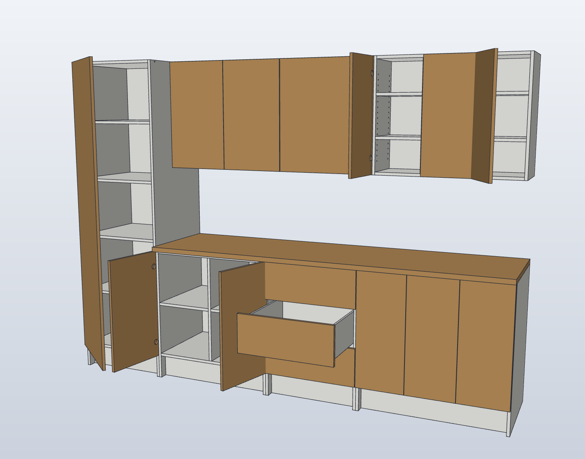

# solidcraft-woodwork

Woodworking plugin for SolidCraft 0.41+. See [PLAN.md](PLAN.md) for the roadmap.

## Functions

Under the **Plugins** menu:

- **Cabinet…** builds a box carcass: sides, top, bottom, shelves, back and optional plinth.
  Vertical dividers split it into equal compartments, each with the same shelves.
  Options: back in a groove or overlaid, 32 mm shelf pin holes, overlay doors with hinge cup
  holes (one, two, or one per compartment). Each panel is an ordinary named body.
  The cabinet stands on Z = 0, centred on the origin.
  - It is a component of its own, inside whichever component is active, so it moves as one
    piece and a room component can hold its cabinets.
  - **Drawers** makes it a drawer unit: a stack of equal drawers with overlay fronts and
    boxes sized for 12.7 mm ball-bearing slides.
  - **Handle holes** drills the doors and drawer fronts for a knob (one 5 mm hole) or a
    pull (two, 128 mm apart).
  - Every door and every drawer is a component of its own inside the cabinet, held by a
    joint: doors hinge open to 110 degrees, drawers slide out. Drive the joints to open them.
    The cabinet is grounded so they have something fixed to open against; unground it to
    move it.
  - **Place** puts it against the cabinet you have selected (any part of it): to the right,
    to the left, or on top, backs flush. That cabinet must stand square to the axes.
  - Its sizes are design parameters (`Name_width`, `Name_height`, `Name_depth`,
    `Name_thickness`, ...). Change one in the Parameters table and the cabinet follows.
    The counts (shelves, dividers, doors) are fixed once it is built.
  The Units field switches the sizes between mm and inches.
- **Corner cabinet…** builds an L-shaped cabinet for a corner of the room, with the return on
  the left or the right: L-shaped bottom, top and shelves, optional plinth, and a door on each
  front. It is parametric, takes a material and can be placed like the box cabinet.
- **Joinery…** drills the selected cabinet where its sides meet the bottom and top: holes for
  7 x 50 confirmat screws, or for 8 x 35 dowels. The holes follow the cabinet's parameters; their number is set when they are drilled.
- **Material…** gives the selected cabinet, or only the selected parts (the doors, say), a
  board material: birch plywood, MDF, white melamine or oak. New cabinets get one in the dialog.
- **Cut list** returns every board as length x width x thickness with quantities, and as CSV.
  In a design set to inches or feet it lists inches as fractions to 1/32.
  It also estimates the 2440 x 1220 sheets to buy per material and thickness (area plus
  15 % waste, not a cutting layout).
  And it counts the hardware: hinges, drawer slides, shelf pins, screws or dowels, handles.

## Install

1. Download `woodwork-<version>.zip` from the [latest release](../../releases/latest)
   (under **Assets**, not the source code zip).
2. In SolidCraft open **Preferences > Plugins** and choose **Install plugin...**

The functions then appear under the **Plugins** menu. Needs SolidCraft 0.41 or later.

## Build from source

Needs Rust with the `wasm32-unknown-unknown` target, `wasm-tools` and Python.

    python build.py            # test, build, package, end-to-end test
    python build.py --install  # also install into SolidCraft

The package lands in `dist/woodwork-<version>.zip`. It can also be installed from
Preferences > Plugins > Install plugin…

## Example

The kitchen in the picture is in the repo:

- [`examples/kitchen.sc`](examples/kitchen.sc): the design. Open it in SolidCraft; it needs no plugin.
- [`examples/kitchen-cutlist.csv`](examples/kitchen-cutlist.csv): its cut list, 94 boards.
- [`examples/kitchen.py`](examples/kitchen.py): the script that built both, using every function of
  the plugin: cabinets placed against each other, melamine carcasses with oak fronts, screws
  and dowels, doors and a drawer left open on their joints.

To rebuild it, run `python build.py` and then `python examples/kitchen.py`.

## Licence

MIT, see [LICENSE](LICENSE). `wit/plugin.wit` is SolidCraft's plugin interface, from
[tangency-labs/solidcraft](https://github.com/tangency-labs/solidcraft) (MIT OR Apache-2.0).

## Layout

- `plugin.json`: manifest. Entries, their input forms, and the app commands used.
- `src/lib.rs`: entry dispatch and the wasm guest.
- `src/kit.rs`, `src/cabinet.rs`, `src/corner.rs`, `src/joinery.rs`, `src/material.rs`, `src/cutlist.rs`: one module per
  function, plain Rust with unit tests.
- `src/select.rs`: finds the cabinet that is selected.
- `build.py`: build, package and end-to-end test through `solidcraft-cli`.
