# Using Woodwork

The functions are under **Plugins > Woodwork** and as buttons on the ribbon. Each opens a
dialog; the cabinet you are about to make is previewed in the model before you press Run.
A dialog shows only the fields that apply to your choices (SolidCraft 0.46): the door fields
appear when there are doors, the reveal and handles when there are doors or drawers, the drawer
front height when there are two or more drawers or drawers with doors, and where they go when there are doors too, the back's
thickness when there is a back, and a sink base has no shelf or divider fields, and drawers only
without doors. A field with a **More about this field** link under it opens its part of this
guide (SolidCraft 0.50).

- [Cabinet](#cabinet)
- [Corner cabinets](#corner-cabinets)
- [Building a run: Place and Match selected](#building-a-run-place-and-match-selected)
- [Changing sizes](#changing-sizes)
- [Edit a cabinet](#edit-a-cabinet)
- [Material](#material)
- [Woodwork settings](#woodwork-settings)
- [Apply settings](#apply-settings)
- [Panel](#panel)
- [Mobile base](#mobile-base)
- [Worktop](#worktop)
- [Cut list](#cut-list)
- [Drawing](#drawing)
- [Good to know](#good-to-know)

## Cabinet

| | |
|---|---|
| 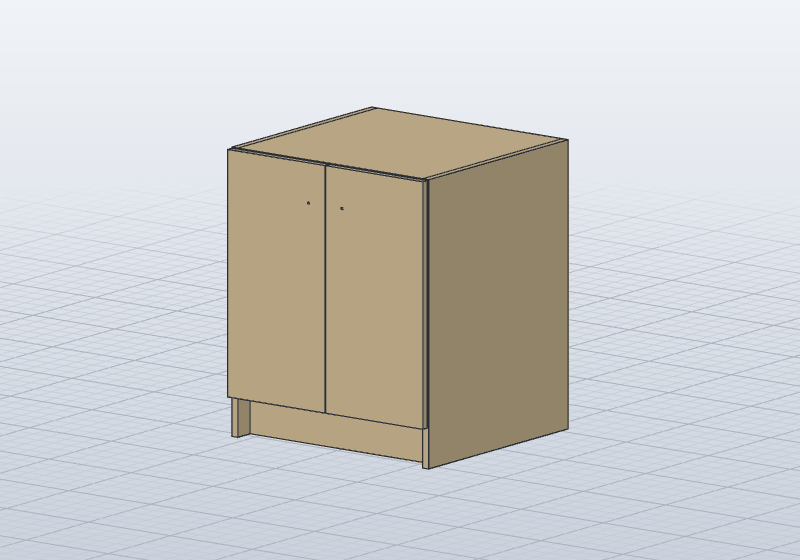 | 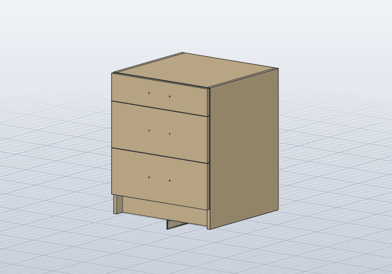 |
| *A cabinet with two doors, a shelf and knobs, on a plinth.* | *Three drawers: the top one 140 mm, the others share the rest.* |
|  | |
| *A drawer over two doors, on a rail.* | |

**A combination that cannot be made is said at once.** When the fields do not go together (three
doors without the two dividers behind them, more drawers than the height holds, a depth too
small), the preview shows nothing and the field it is about says why in its tooltip, such as Doors:
"Doors must be 0, 1, 2 or one per compartment (dividers + 1 = 1 here): nothing is made or
previewed until this is changed". Edit picked does the same for a change, and Woodwork settings
for settings a new cabinet would refuse (casters on a plinth lower than 50 mm). The dialog's Run
stays on: SolidCraft gives a plugin no way to turn it off, and a Run then fails with the same
reason.

One dialog for every cabinet: **Shape** is a Box (below) or a corner cabinet, L-shaped or
diagonal (see [Corner cabinets](#corner-cabinets)); the dialog shows only the fields of the
shape chosen, and a corner starts at its own sizes (900 wide, 900 return). Corner
cabinets used to have a dialog of their own, `woodwork.corner`: it is gone, and a script makes one with
`woodwork.cabinet` and `"shape": "L-shaped"` or `"diagonal"` (its doors are `corner_doors`).

A box builds a carcass: sides, top, bottom, shelves, back and optional plinth. Each panel is an
ordinary named body. The cabinet stands on Z = 0, centred on the origin, and is a component
of its own inside whichever component is active, so it moves as one piece and a room
component can hold its cabinets.

| Field | What it does |
|---|---|
| **Mode** | **Auto** (the default) goes by what is picked: a door, drawer front, shelf, divider or drawer part of a cabinet changes that cabinet, as Edit picked (see [Edit a cabinet](#edit-a-cabinet)); a side, top, bottom or back makes a new cabinet next to it (with Match selected and Place as usual); nothing picked, a new cabinet. Mode's hint says which ("Auto: editing Cabinet 2 (a door is picked)"); pick another part to switch. **New cabinet** and **Edit picked** do that whatever is picked. |
| **Kind** | Standard or a sink base: see [Sink base](#sink-base). |
| **Units** | The sizes in the dialog in mm or inches. Inches puts inch sizes in the fields you have not changed. |
| **Width, Height, Depth, Panel thickness** | The outside sizes. Height includes the plinth. |
| **Back**, **Back thickness** (Woodwork settings) | In a groove, overlaid on the rear edges, or none. |
| **Wall mount** (the cleat's height and thickness in Woodwork settings) | How the cabinet hangs on the wall: none, a French cleat, a hanging rail or a steel rail. See [Wall mount](#wall-mount). |
| **Dividers** | Vertical dividers, splitting the inside into equal compartments, each with the same shelves. |
| **Shelves** | Shelves in each compartment, evenly spaced. |
| **Drawers** | Drawers with fronts and boxes sized for 12.7 mm ball-bearing slides, drilled for them (see [Hinges and slides](#hinges-and-slides)). Alone they fill the front and the cabinet has no shelves. With one or two doors they sit above or below the doors (**Drawers at**), with a fixed rail (`Name Rail`) between the sides behind the gap between the drawers and the doors, and the shelves on the doors' side of it; with inset fronts the rail stands a panel back, behind them. Not with dividers: with drawers the dialog hides Dividers. |
| **Drawer front height** | 0 is Auto: 150 mm beside doors, all alike for drawers only. Otherwise at least 100 mm (4 in; more with boards thicker than 16 mm beside doors, as the box needs room), and a lower value is refused with a message that names the minimum. With doors: the height of each drawer front. Drawers only: the top drawer's front, and the others share what is left equally (a lower top drawer, deeper ones below). Typical: 150 mm beside doors, 140 mm for the top of a stack. In the dialog's units. Once used it is the design parameter `Name_drawer_height`: change it in Parameters and the fronts, doors and rail follow. Going back to all alike (or 150 mm) is done with an Edit, not by setting the parameter to 0. |
| **Size by**, **Drawer inside width** and **depth** | With drawers: Outside or Drawer inside. See [Size by drawer inside](#size-by-drawer-inside). |
| **Drawers at** | With doors too: Top puts the drawers at the top and the doors below them, Bottom the drawers at the bottom on the plinth and the doors above. |
| **Plinth / toe kick** | Yes (the default) or No. See [Plinth / toe kick](#plinth--toe-kick). |
| **Shelf pin holes** | 32 mm system rows of 5 mm holes; the shelves rest on them. Off, the shelves are fixed and joined by Joinery inside (a cabinet made before 0.2.0 keeps them unjoined, as it has no method). |
| **Shelf support** | With Shelf pin holes on: **Pin holes** (the rows above, the default) or **Pilaster strips**: a 16 mm wide, 5 mm deep dado at the front and back of each side (and each divider face carrying shelves; on a corner cabinet each end and each back) over the shelves' height, a metal strip in each, flush with the face, and four clips under each shelf (eight under a corner cabinet's). The strips and clips are models, as the hinges are: the cut list leaves them out of the boards and buys them in the hardware, the strips by their length ("Shelf pilaster strip, 652 mm") and the clips by count. 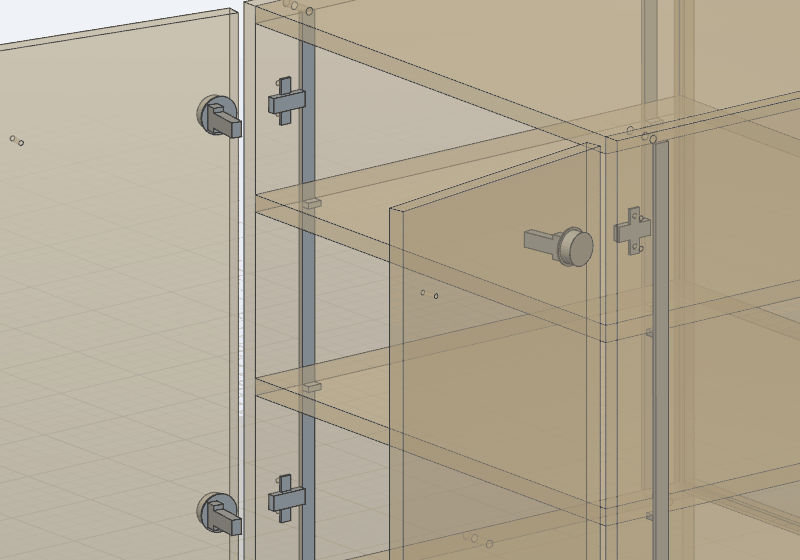 |
| **Doors** | Doors with 35 mm hinge cup holes, and the hinge plates' screw holes in the sides: one, two, or one per compartment. |
| **First door hinged** | The side the first door is hinged on. The next ones alternate, and two doors always open from the middle. With three overlay doors or more the end doors always hinge on the sides, so only the doors between hinge on a divider; this is then the side the first of those hinges on (Right: the middle one of three hinges on its right), and the rest alternate. |
| **Drawer box thickness**, **Drawer bottom thickness** (Woodwork settings) | The drawer boxes' sides, front and back (12 mm by default, 10 to 25) and their bottoms between the sides (6 mm, 3 to 19). The box keeps its outside size; the front, back and bottom get smaller. The parameters `Name_drawer_thickness` and `Name_drawer_bottom`: change them in Parameters for one cabinet, and Edit keeps them. |
| **Drawer side height**, **Drawer back height** (Woodwork settings) | Lower drawer box sides and back: 0 (the default) keeps the sides as tall as the box and the back as tall as the sides; otherwise their height, at least 50 mm (a slide is 45 mm high). The back may be lower or taller than the sides, so low sides can have a tall back. More than a drawer's box is that box's height, for the sides and the back alike. They stand on the box's bottom edge, the slide's screw holes in the middle of the side; the box's front, or an integrated front, stays full height. A finger-jointed box takes it too: the back's corner fingers are laid out over the height it shares with the sides, and the taller board stands whole above the other. The parameters `Name_drawer_side_height` and `Name_drawer_back_height`: change them in Parameters for one cabinet; the sides never grow past the box.  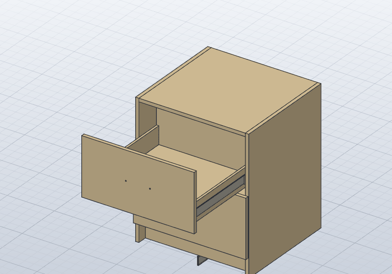 |
| **Fronts** (Woodwork settings) | Overlay or inset. See [Fronts: overlay or inset](#fronts-overlay-or-inset). |
| **Reveal** | The gap around and between the fronts, 0.5 to 6 mm (2 by default), always in mm, also on an inch cabinet. Overlay: also how far the fronts stop short of the carcass's outside edges. Inset: the gap all round inside the opening. On a cabinet with doors or drawers it is the design parameter `Name_reveal`: change it in Parameters and the fronts follow. |
| **Drawer handles**, **Door handles** (Woodwork settings: Drawers and Doors; and Edit for one cabinet) | Each picks freely what the drawer fronts, or the doors (a corner cabinet's too), get; Bottom tab is for drawers only. Drills the doors and drawer fronts for a knob (one 5 mm hole) or a pull (two, 128 mm apart). Or no handle at all, the front is the grip: **Grip edge** bevels the back of the grip edge at 45 degrees (the panel thickness less 6 mm along both faces, 12 mm on an 18 mm front), so fingers reach behind the front; **Finger groove** routes a rounded groove 20 mm high and 10 mm deep along the front face, its middle 25 mm from the grip edge. Both run the front's whole width and follow a resize. They go on the edge Handle position gives: a drawer front's top (Top or Auto) or bottom (Bottom), a door's top or bottom (Auto: the top on a floor unit, the bottom on a wall unit); on a corner cabinet's folding pair on the door that folds. A grip edge's front stops **Grip gap** (Woodwork settings, 20 mm by default, 5 to 50; the parameter `Name_grip_gap`) short of its grip edge, the bevel on the new edge, so a finger fits in the gap and behind the bevel; a drawer's box is that much lower too. A grip edge with Handle position Middle is refused (a finger groove there goes on the top edge). **Bottom tab** (drawers only) makes each drawer's bottom panel the pull: it runs forward under the front and sticks out 12 mm past its face, **Tab width** wide (Woodwork settings, Drawer settings: 120 mm by default, never wider than the box inside), its two front corners rounded, with a shallow cove along its underside (a 6 mm radius, 3 mm deep, or half a thinner bottom) for a finger to hook from below. The front is cut away from its lower edge up to the bottom where the tab passes; the rest of the front keeps its height, so the gaps between drawers stay. The bottom sits a little above the front's lower edge (a panel and 8 mm on an overlay front), as the lowest drawer's bottom must clear the carcass. It works with a separate or an integrated front alike. The tab is as thick as **Drawer bottom thickness**: 12 mm or more takes the pull well. The cut list gives the bottom with its tab, that much longer. No handles go in the cut list's hardware. |
| **Handle position** (Woodwork settings) | Near the top, in the middle or near the bottom of a door. On Auto: near the top on a floor unit, near the bottom on a wall unit. On a drawer front the handle lies across: in the middle on Auto, or 40 mm from the front's top or bottom edge. With a grip edge or finger groove: the door's top edge (Top, Middle, or Auto on a floor unit) or its bottom edge (Bottom, or Auto on a wall unit). |

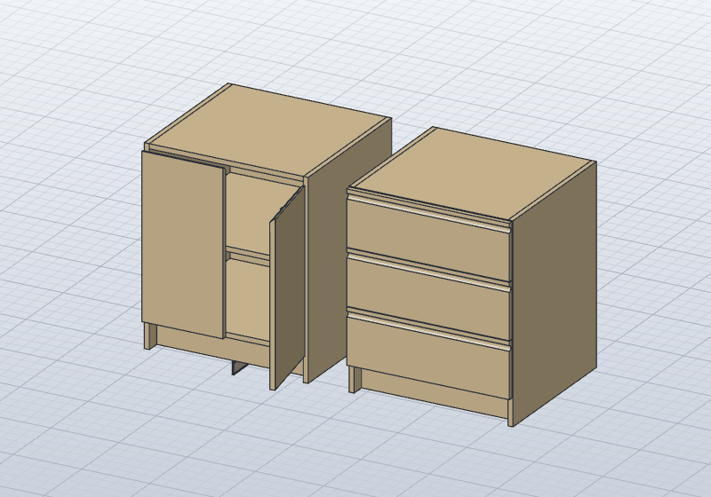

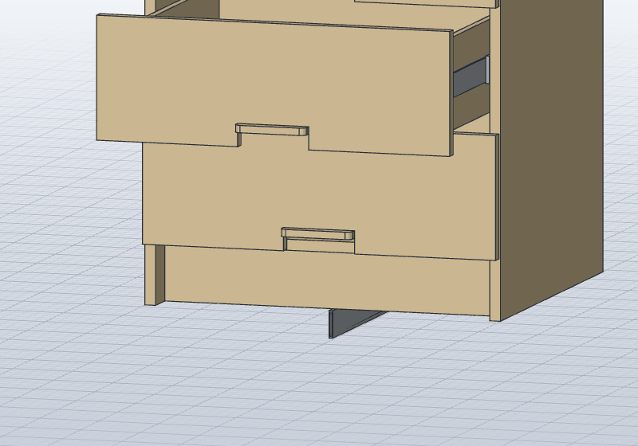

**Front style** (Woodwork settings, and Edit for one cabinet): **Flat** (the default), or
**Vertical grooves** or **Horizontal grooves** cut into the face of every door and drawer front,
corner doors too. Woodwork settings give their **Groove shape** (Square: a flat bottom; Round: a
half round, fluted; V: a 90 degree V, #182), **Groove spacing** (50 mm by default: about how far apart they are, evened
out over each front so the strips between them are alike) and **Groove depth** (3 mm; the grooves
are twice as wide). Each groove runs the front's whole length. They are the parameters
`Name_groove_spacing` and `Name_groove_depth`, and the count follows a resize. A groove must stay
clear of the hinge cups behind it: on a cabinet with doors at most the thickness less 14 mm
(4 mm on an 18 mm door), without doors at most half the thickness.

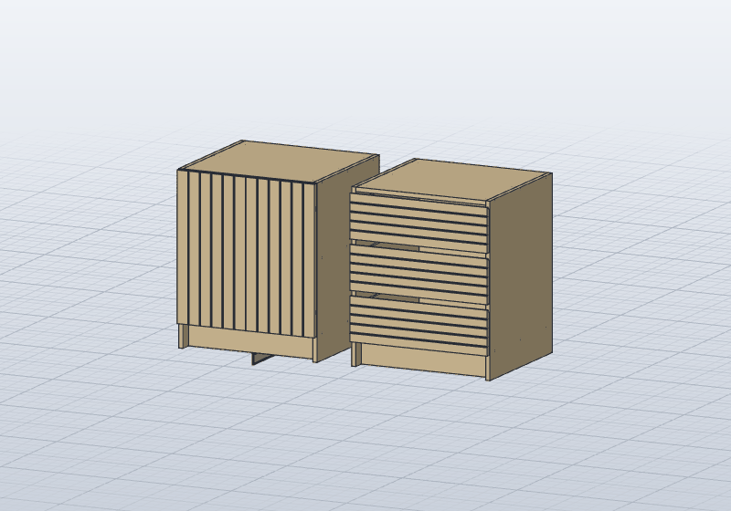

*V-grooved fronts: vertical V grooves on the doors (left), horizontal ones on the drawers (right).*

**Front style: Shaker** makes each door and drawer front a frame and panel: two stiles (full
height) and two rails between them, **Frame width** wide (Woodwork settings, 60 mm by default,
55 to 150), round a panel of **Panel thickness** (6 mm by default) centred in the front's
thickness and set 8 mm into a groove all round. They are separate boards in the cut list (the
rails' grain across, the stiles' and the panel's upright, the panel at its own thickness), and
the parameters `Name_frame_width` and `Name_panel_thickness`. A door's own name (`Name Door`) is
the stile it hangs on, which takes the hinge cups; the handle goes in the middle of the other
stile. The rails are butted between the stiles (no tenon or dowels are cut). A door must be at
least twice the frame width plus 60 mm each way; drawer fronts lower than that stay flat. A grip
edge or finger groove needs flat fronts.

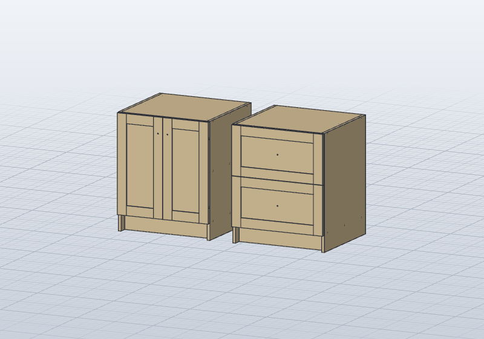

**Front style: Glass** makes the doors and drawer fronts Shaker frames round a 4 mm glass pane
in the groove (`Name Door glass`, `Name Drawer 1 Front glass`, the see-through Glass material).
Drawer fronts too low for a frame stay flat, as with Shaker. No hole goes into the glass: a glass
drawer front's knob or pull goes in the middle of its top rail with Handle position Top or Auto,
of its bottom rail with Bottom, centred across the front. Middle is refused, as the handle would
go through the glass. A bottom tab's notch is cut in the bottom rail. The cut list buys the panes by size in the hardware list
("Glass, 4 mm, 612 x 492 mm") and lists only the frame's boards; Material leaves the glass as
it is.

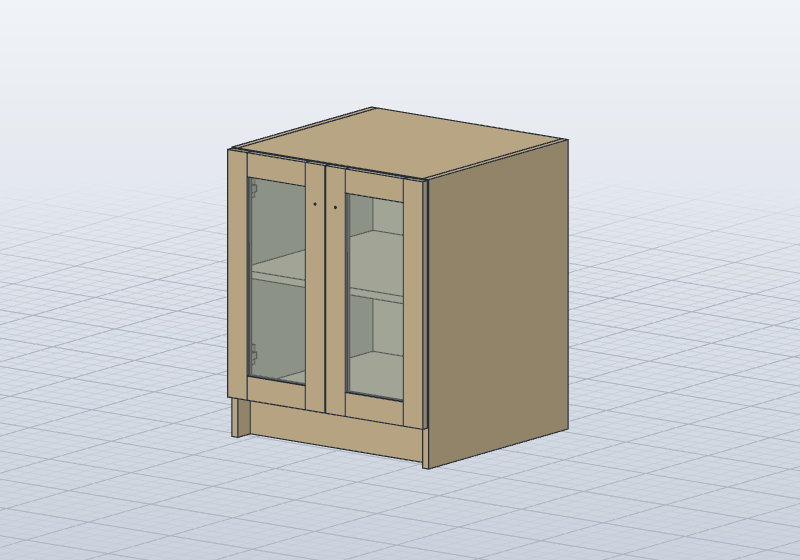
| **Labels** (Woodwork settings) | Writes each board's name on it, the name the cut list has, as text in a sketch on the board's face. It stays in the middle of the board when the cabinet changes size. |
| **Selected cabinet**, **Match selected**, **Place** | See [Building a run](#building-a-run-place-and-match-selected). **Line**, **Start at**, **Offset**, **Faces**, **Width from line** and **Height from line** show with Place Along a line: see [Along a line](#along-a-line). |
| **Material** | The board material of every panel. Change it later with [Material](#material). |
| **Name** | The prefix of the panel names. A name that is taken is numbered: Cabinet, Cabinet 2, Cabinet 3; after Base 1 comes Base 2. |

The joinery and the hardware (Joinery, Joinery inside and their sizes, Hardware models, Hinge
opening, Slide type), and the fields marked (Woodwork settings) above, are no fields here: they are the same for the whole design, set in
[Woodwork settings](#woodwork-settings), and a new cabinet takes what is stored there (dowels,
models shown, 110 degrees and full extension when nothing is). It remembers them, so changing
the settings later does not change it until Apply settings builds it again with them. The slide
length is Auto (the longest that fits its depth).

### Size by drawer inside

With drawers: Outside (the default) takes Width and Depth as they are. Drawer inside works them out from the size wanted inside each drawer box (such as 672 x 672 mm for a 16 x 16 Gridfinity grid of 42 mm bins): the box's sides, the slides' 12.7 mm a side (or a dado runner's play; undermount: Blum's 42 mm, and the shortest slide that holds the box, with 3 mm behind it), the carcass sides, the room behind the box (none on dado or strip runners, where the box reaches the back; a sink base's boxes are half the shelf depth) and the back. The cabinet is made with that outside size, which the summary gives, and remembers the drawer inside size: when the slides, the drawer boards or anything else around the boxes changes later (Woodwork settings and Apply settings, or Edit), its outside is worked out again so the boxes keep their inside. Edit shows Size by and the inside sizes for it; a width changed in Parameters is replaced by the one the inside needs at the next Edit or Apply settings. Not with Match selected.

### Plinth / toe kick

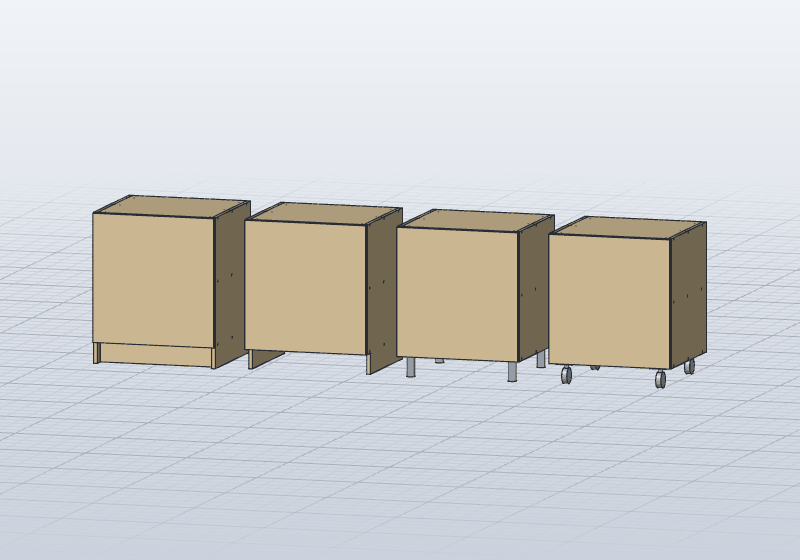

*Plinth types: board, notched sides, legs and casters.*

Yes (the default): the plinth set in Woodwork settings, its height (100 mm unless set), type and set-back. No: none, for a wall cabinet or a cabinet on top. With Match selected the plinth is the selected cabinet's, as before.

**Plinth / toe kick type** (Woodwork settings): **Board**: a board under the cabinet, Plinth set-back from the front (`Name Plinth`). **Notched sides**: no board; each side has a toe kick Plinth set-back deep cut out of its front bottom corner, as high as the plinth, and the bottom sits on top of it, so you can fit one long plinth board along a whole run yourself (the cut list gives a notched side's size over the notch and says so). **Legs**: no board; the whole carcass stands on adjustable legs as high as the plinth (`Name Leg 1` and on, 40 mm round, 50 mm in from the edges: four, six on a cabinet over 900 mm wide), which the cut list counts as hardware and leaves out of the boards. An end panel still reaches the floor. **Casters**: the same, on locking casters so the cabinet rolls (`Name Caster 1` and on: an 80 mm plate under the bottom and a wheel, at the legs' places but 50 mm in from the inside of the sides; four 4 mm pilot holes for each plate in the bottom panel, 60 mm apart). Needs a plinth of at least 50 mm, counted as "Caster, locking" in the cut list's hardware; an end panel stops at the cabinet's bottom. Corner cabinets too.

**Plinth / toe kick set-back** (Woodwork settings): With a Board or Notched sides plinth: how far the board, or the notch, is back from the front. 50 mm (2 in) by default, 0 to 200, less than the depth less a panel. The parameter `Name_plinth_setback`.

### Fronts: overlay or inset

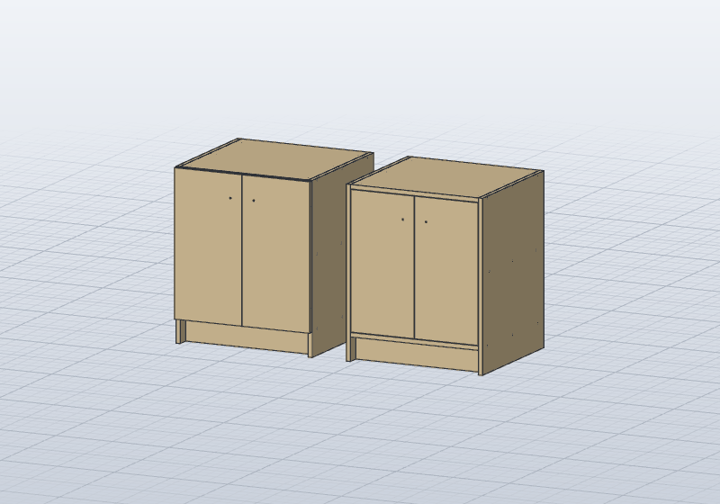

*Fronts: overlay (left) cover the carcass edges, inset (right) sit inside it.*

Overlay: the doors and drawer fronts cover the carcass edges. Inset: they sit inside the opening between the panels, their faces flush with the carcass front; the shelves, dividers and drawer boxes stand back behind them. Inset doors in a cabinet with one door per compartment each fill their own compartment.

### Doors and drawers move

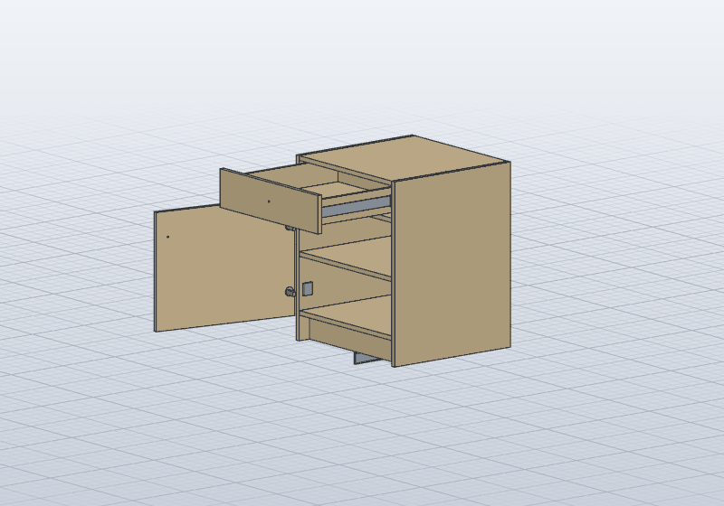

*Doors and drawers open on their joints, with the hinge and slide models.*

Every door and every drawer is a component of its own inside the cabinet, held by a joint:
doors hinge open as far as their hinges (**Hinge opening** in Woodwork settings, 110 degrees
unless chosen), drawers slide out as far as their slides (**Slide type**, the same). Drive the joints to open them. A door
turns about its front edge, as on a cup hinge, so it clears the door of the next cabinet; an
inset door swings out of the opening clear of the side.

The cabinet is grounded so they have something fixed to open against; unground it to move
it. A cabinet placed against another is held to that one instead.

### Hinges and slides

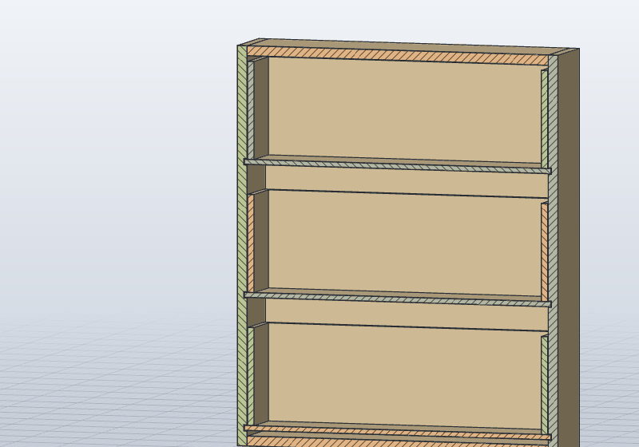

*Dado runners: each drawer's bottom runs in a groove in the sides.*

A box cabinet drills the holes its hinges and drawer slides need, every size and place an
expression over design parameters that all cabinets share, made the first time a cabinet
needs them. Change one in Parameters and every cabinet's holes follow:

| Parameter | Default | What |
|---|---|---|
| `HW_cup_d`, `HW_cup_depth` | 35 mm, 13 mm | The hinge cup, from the door's back face |
| `HW_cup_inset` | 22.5 mm | The cup's middle, in from the door's hinge edge |
| `HW_screw_d`, `HW_screw_depth` | 5 mm, 10 mm | Screw holes in the sides, for hinge plates and slides |
| `HW_setback` | 37 mm | Those screw holes behind the front of the opening (the shelf pins' line); on a drawer box, behind the box's front |
| `HW_pitch` | 32 mm | A hinge plate's two holes are this far apart, about the cup's height, and the cups go on this grid; a slide's two holes are whole pitches apart |
| `HW_slide_t` | 12.7 mm | A slide's thickness: each drawer box is twice this narrower than the opening |
| `HW_box_screw_d`, `HW_box_screw_depth` | 3 mm, 8 mm | A slide's screw holes in a drawer box's sides |

- Each door gets its cups (two up to 900 mm high, three up to 1600, four up to 2000, five
  above: about 100 mm from the ends and the rest evenly between) and the side it hangs on a
  plate's two holes beside each cup. With three overlay doors or more, a door hinged in the middle of
  the cabinet hangs on a divider that it covers only half of (the next door covers the
  other half): it gets half overlay hinges, the model's arm cranked 9.5 mm and a line of
  their own in the cut list's hardware ("Hinge, cup, half overlay"), and its cups only: the
  plate would go on the divider, which is not drilled. The end doors always hinge on the
  sides, so as few doors as possible hang on a divider (one of three). Inset doors each fill
  their own compartment and simply alternate from the first; one hinged on a divider gets
  its cups only.

  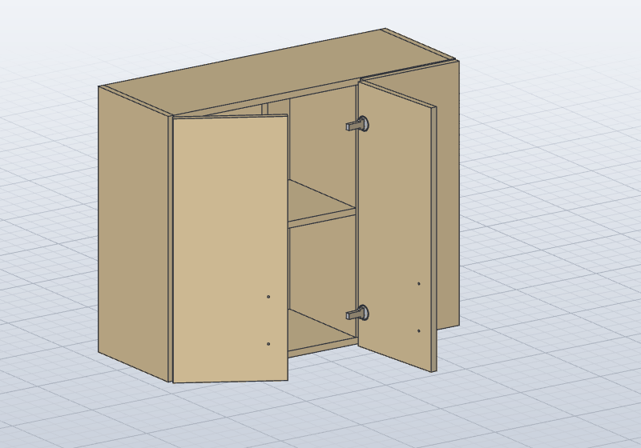

- **Double dividers** (Woodwork settings, No by default): where overlay doors meet on every
  divider (one door per compartment), each divider is two boards side by side, `Divider 1 L`
  and `Divider 1 R`. Every door then covers a whole board and takes standard hinges, and a
  door hung on a divider gets its plates' holes in its own board; the shelves' pin holes are
  blind, from each board's outer face. One more board per divider in the cut list. With other
  door counts, or inset fronts, the dividers stay single.

  

- Each drawer box gets two holes in each side, in the middle of its height, and the carcass
  side beside it two more at the same height: `HW_setback` behind the front, and as many whole
  `HW_pitch` further as the slide's length leaves before `HW_setback` from its end. A sink
  base's false front has none. A drawer box must be at least 250 mm deep, for the shortest
  slide.
- **Undermount slides** (Slide type Undermount partial or full, after Blum TANDEM and the
  like): the box is made to fit them. Inside it is 42 mm narrower than the opening (Blum's
  rule), so its sides may be 16 mm at most (thicker is refused). It is as long as the slide:
  250, 270, 300 to 600 mm or 9, 12, 15, 18 or 21 in, the longest that fits the inside depth
  with 3 mm behind it, or the one Edit picks. Its bottom sits 13 mm up, the back is notched
  35 mm in from each side and 13 mm high for the runner, with a 6 mm hole 10 mm deep for its
  rear hook beside each notch, and a runner model (12 x 14 mm) under each side. No holes in
  the box or carcass sides. The sizes come from the makers' sheets and are not all confirmed:
  check yours. Partial pulls out three quarters of the length, full all of it; the cut list
  names them `Drawer slide, undermount full extension, 500 mm, pair`.
- **Dado runners** (Slide type Dado runners, the drawer's bottom running in a groove, a dado, in each side): no slides, holes or models. The box stands 1 mm
  clear of each side on a bottom wider than it, whose edges run in a groove in each carcass
  side (`Name Side L runner 1` and on, front to back), as high as the bottom plus 1 mm of play
  above and below, 6 mm deep, the bottom 1 mm short of its end. The parameters
  `Name_runner_depth` (3 mm up to the panel thickness less 6) and `Name_runner_play`. With no
  slide to stop it, the box runs all the way to the cabinet's back and stops against it (not on a
  sink base, whose boxes are half depth, or with Back None, where nothing stops it), so
  pushing the drawer shut presses on the back, not on the front and its joints (an overlay
  front stays its reveal off the carcass). The drawer pulls out two thirds of its box's depth. The cut list notes the grooved
  sides and counts no slides. A 9 mm bottom (Drawer bottom thickness) runs better than 6.
- **Strip runners** (Slide type Strip runners, #146): the same, for a workshop without a router
  or dado blade. Instead of a groove, a wooden strip (`Name Side L strip 1` and on, 12 mm thick
  and 18 mm high) is screwed to each side under each drawer, from the front of the opening to
  the back. The drawer's bottom is wider than its box and rests on the strips' tops, set as much
  higher as the strip needs to clear what is below it (the box's top stays where it was), and the
  box stands the strip's thickness plus 1 mm of play clear of each side. **Strip thickness**
  (6 to 30 mm) and **Strip height** (10 to 60 mm) in Woodwork settings' Drawers set them for new
  cabinets. After that they are the parameters `Name_strip_thickness` and `Name_strip_height`,
  next to `Name_runner_play` (less than the strip's thickness). The strips are boards in the cut list, and no slides are counted. Their
  screw holes are not drilled.

  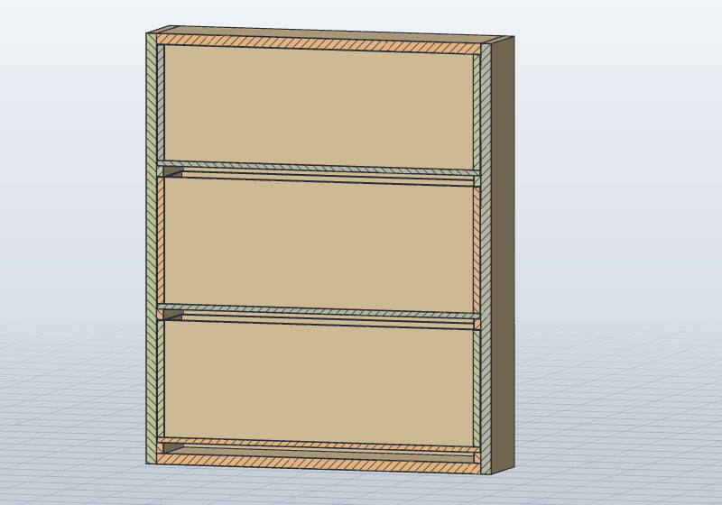

  *Strip runners: each drawer's bottom rests on a wooden strip on each side, no groove.*
- **False back** (dado and strip runners, #258): a runner drawer has no stop, and pulled too far
  it tips out. So each runner drawer's box gets a second back inside it,
  `Name Drawer 1 False back`: a board between the box's sides, as high as them and as thick as
  the box's boards, its front face at four fifths of the box's depth. It marks how far the
  drawer may come out and keeps what is in it in the front four fifths. It follows a resize and
  is a board in the cut list. Drawers on slides have none.

  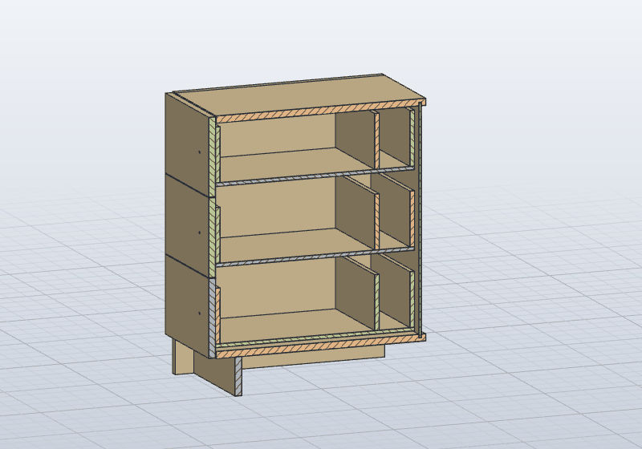

  *A runner drawer pulled out: its false back at four fifths of the box's depth.*
- **Slide length** (Auto, set by the cabinet's depth): the standard side-mount
  ball-bearing lengths, 250, 270 and 300 to 650 mm in steps of 50, or 10 to 28 in in steps of
  2. **Auto**
  takes the longest one in the cabinet's unit that fits the drawer boxes with 3 mm behind it
  (a 560 mm deep cabinet: 500 mm, or 20 in); a length that does not fit is refused. The cut
  list's hardware names it with the type ("Drawer slide, full extension, 500 mm, pair");
  drawers made before have the plain "Drawer slide, pair". Undermount slides are not offered
  yet.
- **Hardware models** (Woodwork settings, then Apply settings for those made): with **Shown**,
  the default, each hinge is a model of a concealed hinge: a cup in its hole with a 40 mm rim
  on the door, a boss over it and an arm behind the door, which swing with it, and a
  cruciform mounting plate (8.5 mm thick, 40 deep, its wings up and down over the plate's two
  holes) on the side, which stays; the arm lies on the plate.

  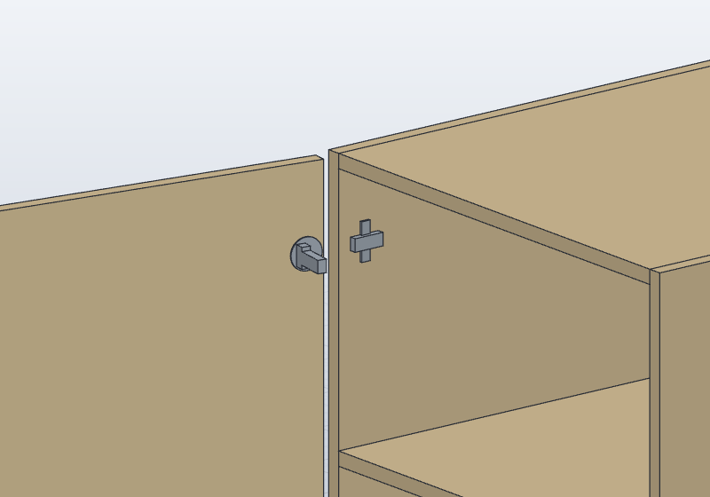
 Its arm is
  cranked 18 mm on an inset door and 9.5 mm on a door hung on a divider (half overlay). Each
  slide is bars as long as the slide: one on the drawer box, which slides out with it, one on
  the carcass side, and on a 3-section slide a middle one between them (it moves with the
  drawer, not half as far as a real one). They follow the
  cabinet's and the `HW_` parameters. They only show: the holes are cut as before,
  and the cut list, drawings' board lists, Worktop, Place and Joinery leave them out. Every
  model is a copy of a component in `Woodwork hardware` at the root (`HW hinge`, `HW hinge
  crank 18`, `HW hinge plate`, and `HW slide cabinet 500 mm`, `HW slide middle 500 mm` and
  `HW slide drawer 500 mm` for each slide length used), made by the first cabinet that needs it and kept when cabinets are edited or deleted.
  SolidCraft cannot keep a plugin's parts hidden, so those stand just under the floor under
  the back of the first cabinet: no view from above sees them, but they show when you look
  from below or through see-through boards. A corner cabinet's second door, which folds on
  the first, has its cup holes but no hinge models. In a design made with an earlier build, a model whose definition was made
  after the first cabinet's (a cranked hinge, another slide length, or the hinge when the
  first cabinet had only drawers) can float beside its door or drawer: delete that `HW ...`
  component under `Woodwork hardware` (its copies go with it) and Edit the cabinets that used
  it;
  delete `Woodwork hardware` and every model goes with it (the next cabinet makes them again).
  **None** leaves them out. **Shown,
  cutting the cups** lets the hinge models cut the cups themselves; it needs SolidCraft 0.47 or
  later, as before that every later run in the design gets much slower. A cabinet too big for
  one run with its models (very many doors) is made without them, and says so in its result.
- **Fastener models** (Woodwork settings, None by default; Shown to look at the joinery,
  best with See-through boards; never with Hardware models None): each dowel, screw (confirmat, plain or pocket), cam lock with its bolt, biscuit or
  Domino is a simple body sitting in its hole (`Name joint Side L Bottom dowels fastener`, the
  rest of a row copies of it, `... fastener (2)`), in the cabinet's component, made per row like
  the holes. Like the hinge models they only show: the cut list, drawings' board lists,
  Worktop, Place and Material leave them out. With See-through boards on you can look at them
  inside the boards. A cabinet remembers whether it has them. They add a feature to the
  history for each joint: in a big design (about 400 features, the sample kitchen's size),
  SolidCraft 0.46 names the faces of later features another way, and a corner cabinet's picked
  chamfer further on is then not found again when an earlier cabinet is deleted or edited (the
  run fails and nothing changes). That is one reason they are off by default; the holes and the
  cut list's counts are the same without them. The sample kitchen shows them only on the units
  on the return, which come last.
- The holes show in the DXF files (a layer per diameter and depth) and the cut list counts the
  hinges and the pairs of slides. A corner cabinet's doors get the same cups on the same grid,
  and the plates' holes in the end the pair hangs on; the diagonal door's ends stand at 45
  degrees to it, so it gets its cups only.
- The cups sit about 100 mm from the door's ends, moved by up to 16 mm so that each plate's two
  holes are on the shelf pins' 32 mm grid: with shelf pins, a plate screw goes into a pin hole,
  or its hole is clear of the rows. The pins keep 32 mm and 37 mm, so a changed `HW_pitch` or
  `HW_setback` moves the plates off the pins' line.
- The screw holes in the sides go `HW_screw_depth` deep, but never closer than 3 mm to the
  outside: in a thin panel they stop short.

### Sink base

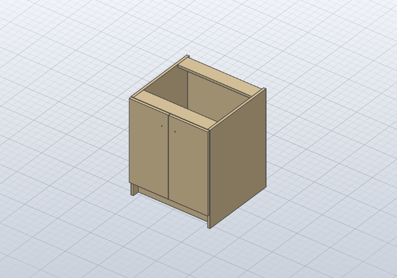

*A sink base: two rails instead of a top, no shelves.*

**Sink base** (Kind: Sink base): no top, but two flat rails between the sides at the top,
each 100 mm deep and a panel thick: `Name Rail front`, flush with the front, and `Name Rail
back`, at the back of the sides in front of the back panel. The sink and its pipes go between
them. It has no shelves, shelf pin holes or dividers, and the dialog hides those fields; an
Edit that makes a cabinet a sink base leaves them out. Doors as usual (none, one or two),
overlay or inset; an inset door stops under the front rail as under a top. Or drawers instead
of doors, like a bathroom vanity (not both: the dialog hides Drawers when there are doors, and
a sink base given both is refused): two or more fronts, laid out as on a drawer cabinet, but
the top one is `Name False front`, fixed to the cabinet in front of the sink, with a handle hole
and no box. Drawer front height sets its height. The boxes below are half the shelves' depth
deep, so they stop short of the trap; for deeper ones, cut a U round the trap yourself. A
sink base with drawers changed back to a standard cabinet with Edit gets full drawers again. The back is your
choice: Back None leaves it open for the pipes. Place works as on any cabinet;
pick a rail or a side to select it, as it has no top. Its joinery fixes the sides to the
bottom and to each rail, one fastener in the middle of a rail.

There is no oven housing: size a tall cabinet for your oven yourself.

### Joinery at build

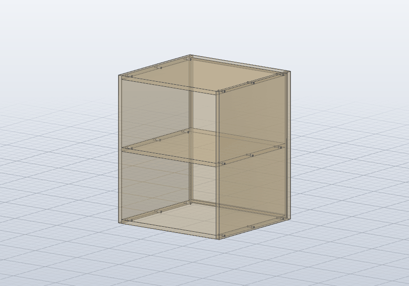

*Dowels at build, with fastener models on and see-through boards.*

**Joinery** (in [Woodwork settings](#woodwork-settings), for the whole design, with the sizes
below; Apply settings takes it to the cabinets made) chooses how the sides are fixed to the
bottom and the top (a sink base's to its bottom and its two rails), and the holes are drilled
as the cabinet is made:

- **Dowels** (the default): wooden pegs glued into both boards, hidden. Each hole is one
  cut through both boards: blind in the side's inner face (5 mm short of coming through, at
  most half the dowel), the rest into the end of the bottom or top, 2 mm longer than the dowel.
  **Dowel diameter** 8 mm and **Dowel length** 35 mm by default; the dowel must be 4 mm
  thinner than the boards and more than twice as long as it is thick.
- **Confirmat screws**: 7 x 50 mm furniture screws from outside, heads showing: a 7 mm hole
  through the side and a 5 mm pilot hole into the end, 50 mm less the side deep. Boards
  under 40 mm only.
- **Screws**: plain 4 x 50 mm wood or chipboard screws from outside, as confirmat: a 4.5 mm
  hole through the side and a 3 mm pilot into the end. Counted as "Screw, 4 x 50 mm".
- **Cam locks** (minifix): a 5 mm hole in the side's inner face for the bolt's thread (11 mm
  deep, less in a thin side), an 8 mm hole along the middle of the bottom's or top's end for its
  shank, and the cam's housing (**Cam size**, 15 mm) from the end board's inside face, where the
  bolt reaches it: **Cam bolt length** (35 mm) less the thread, 24 mm from the side. The housing
  goes 85 % of the cam's size deep, leaving 3 mm of the board. Boards of 12 mm or more. Spaced
  as dowels; counted as "Cam lock and bolt, 15 mm". The cabinet comes apart again.
- **Pocket screws**: a 9.5 mm pocket in the bottom's or top's face (**Pocket face**: Outside,
  under the bottom and over the top, hidden; or Inside), at 15 degrees to it, aimed at the middle
  of its end, and a 3.5 mm pilot from there on out through the end and up to 15 mm into the side
  (less in a thin side). The angle is fixed. Spaced as dowels; counted as "Pocket screw, 32 mm".
  Each pocket is a cylinder cut on a slanted axis.
- **Biscuits**: a slot across the joint, half in each board, in the middle of the end's
  thickness, for a flat glued biscuit: **Biscuit size** #0, #10 or #20 (53, 59 or 62 mm long,
  9, 11 or 13 mm into each board, 4 mm thick; drawn as a rectangle, a biscuit jointer cuts a
  half moon) or a Domino 5 x 30 (21 x 5 mm, 15 mm into each board). Spaced as dowels; counted
  as "Biscuit, #20" or "Domino, 5 x 30 mm". The boards must leave 3 mm behind the slot.
- **Dado** (box cabinets): the bottom and top sit in grooves (housings) cut across the sides,
  **Dado depth** (6 mm) deep and as wide as the boards, through from front to back: each is that
  much longer at each end, which the cut list shows (a 600 mm cabinet's bottom is 576, not 564).
  Joinery inside: a divider grows into grooves in the bottom and top, the rail into the sides.
  Glue them; nothing to buy. The depth leaves 3 mm of the side behind the groove at least.
  A corner cabinet refuses it.
- **Finger joints** (the shell only, box and corner cabinets): the bottom and top run through the sides
  to the outside, and the corners interlock in an odd count of equal fingers, the sides keeping
  the outer ones. **Finger width** (Woodwork settings) is 0 by default, making the fingers as wide
  as the boards are thick, and following the thickness. Each finger is a box cut, repeated along
  the corner, so the count follows a resize. The cut list gives the bottom and top at their size over
  the fingers (a 600 mm cabinet's bottom is 600) with the note "finger jointed"; the layouts
  and DXF draw rectangles. Glue them; nothing to buy. Not for Joinery inside. A corner cabinet's bottom and top run
  through all four uprights round them, its back through the back return and the back leg's
  end, the back return through the return's end; where two uprights meet, their corner is cut
  out of the bottom and top. Butted (as None) instead where fingers cannot be made: with a
  wall mount the backs stand on the bottom, under the top and against the middle of the ends
  (mortises, not corners), and a diagonal cabinet's bottom and top keep their front edges for
  the slanted front, so they are butted to the two ends. Over a plinth board or notched sides the sides reach below the bottom, where its
  fingers would be closed mortises through the sides (a CNC job): the bottom is then butted (as
  Joinery None) and keeps its own width, unless **Finger-joint
  the bottom too** (Woodwork settings, Joinery; hidden while the stored plinth type is legs or casters) is Yes. On legs or casters, or with no plinth, the
  bottom is finger-jointed as the top. The top is always flush with the sides' top edges.
  **Drawer box joints** (Woodwork settings): Finger joints give the drawer boxes the same
  at their four corners, the box's front and back running through the sides, fingers as wide as
  the box boards are thick, the sides keeping the outer ones.
  **Drawer front** (Woodwork settings): Separate (the default) puts a front board on the drawer
  box; Integrated leaves it out and makes the box's own front board the front, as high, thick
  and placed in depth as the separate front would be (overlay or inset), drilled for the
  handle, in the cabinet's material, but only as wide as the drawer box: its edges are flush
  with the box sides, so finger joints stay open and can be cut at home, and the slide gap
  beside it shows. The rest of the box stays as it was, butted against the front, or with
  Drawer box joints Finger, its sides' fingers running through the front and showing on its
  face. The box's bottom starts right behind the front. The cut list then has one board fewer a
  drawer. A sink base's false front stays.

  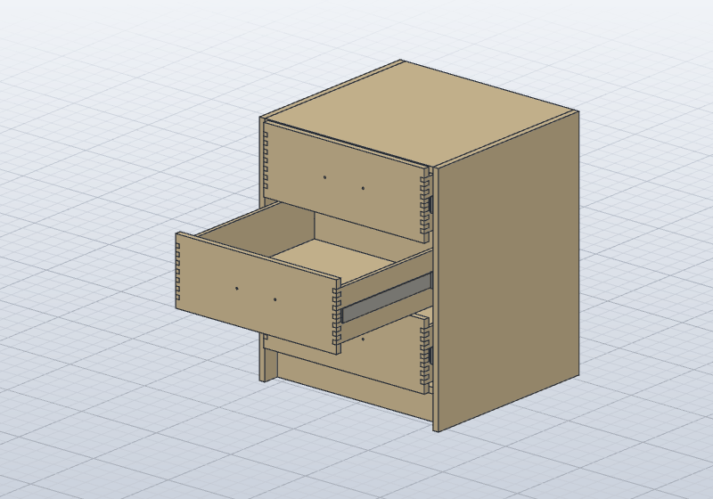
- **None**: butted boards, no holes (as cabinets made before 0.2.0, which an Edit keeps so).

**Joinery inside** does the same for fixed shelves (without **Shelf pin holes** the shelves are
fixed: each
compartment's shelf runs between its side and divider, or two dividers, and is joined at both
ends; a shelf right of a divider has one fewer, half a pitch along, so its holes fall between
those of the shelf on the other side; in a dado the shelf is longer by the two grooves, and
grooves from both sides of a divider must leave 3 mm, so the depth is at most half of the
thickness less 3 mm), for the dividers (each end into the bottom's top face and the
top's underside: a confirmat screw goes in from under the bottom and over the top) and for
the rail between drawers and doors (into the sides, like the bottom). Their rows run along
the shelves' depth, from behind inset fronts to the back.

Along each joint the first and last are **Joint edge distance** (50 mm) from the front and
back edges, and the rest are spread evenly, at most **Joint spacing** (250 mm, 10 in) apart: a
560 mm deep cabinet gets 3 a joint, 230 mm apart. Each hole costs time when the cabinet is
made (about a tenth of a second here, more in a big design), so a closer spacing makes slower
runs. A sink base's rails get one each, in their
middle. The sizes are the cabinet's design parameters (`Name_joint_spacing`,
`Name_joint_edge`, `Name_dowel_d`, `Name_dowel_length`): change one in Parameters, or change
the depth, and the holes follow, their number too. The cut list counts what to buy from the
parameters `Name_dowels`, `Name_confirmats`, `Name_screws`, `Name_cams`, `Name_pocket_screws`, `Name_biscuits_20` (and `_0`, `_10`) and `Name_dominos` (the sum of the joints' counts, so they follow
as well), as "Dowel, 8 x 35 mm" or "Confirmat screw, 7 x 50 mm". Apply settings gives
the cabinets made a changed method (their sizes stay as they are in Parameters); Woodwork settings keeps the two methods and
their sizes for new cabinets. Each joint is a cut in the cabinet's history folder (`Name joint Side L Bottom
dowels`, `... confirmat` and `... confirmat pilot`), repeated along it by a pattern; the joints
that run the same way with the same count share one (`Name joint Side L Bottom dowels row`).

### Wall mount

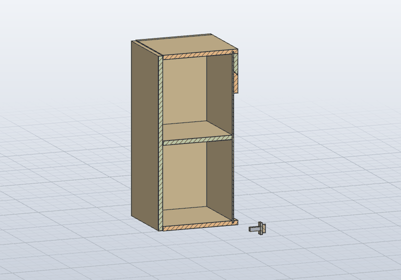

*A wall cabinet on a French cleat, cut through: the back stands in front of the cleat.*

**Wall mount** hangs a box or corner cabinet on the wall (for a corner cabinet see
[Corner cabinets](#corner-cabinets)). Legs and wall mount are independent: a cabinet can have both.

- **None**: as before, nothing to hang it by.
- **French cleat**: `Name Cleat`, a board across the back between the sides, right under the
  top (on a sink base under the rails), its rear face flush with the sides' rear edges. Its
  lower edge is bevelled at 45 degrees: the rear face reaches lowest, the front face stops a
  cleat thickness higher. `Name Wall cleat` is the cleat you screw to the wall: the same length
  and thickness, nested under the cabinet's, its top bevelled to match (low at the wall, high in
  front), its long front face a cleat height tall. The cabinet's weight pulls it into the wall.
  The wall cleat is a body in the cabinet's component, so it moves with the cabinet, is built
  again by an Edit and Match selected, is deleted with the cabinet, and is in the cut list
  as `Name Wall cleat`. **Cleat height** (on the long face, 90 mm or 3.5 in) and **Cleat
  thickness** (18 mm or 3/4 in) are the design parameters `Name_cleat_height` and
  `Name_cleat_thickness`: change them in Parameters and both cleats follow. Twice the height
  less the thickness must fit between the bottom and the top, and a cleat must be taller than
  it is thick. The cut list gives each cleat as a square board thickness x height x length: saw the
  45° bevel along it after cutting (or rip one board twice the height at 45° into both cleats).
- **Hanging rail**: `Name Hanging rail`, a plain board as thick as the panels and 90 mm high,
  in the same place, to screw through into the wall.
- **Steel rail**: nothing is modelled. The cut list's hardware lists `Steel wall rail, <width>
  mm` (one per cabinet, bought to the cabinet's width, grouped by length) and two `Cabinet
  hanger` per cabinet. The cabinet has the parameter `Name_wall_rail` (its width) while it
  hangs on one, 0 after an Edit that takes it away. Hanger models and their holes are not made
  yet.

With a cleat or a hanging rail the back stands in front of it: in a groove, the groove is the
board's thickness from the rear instead of 12 mm; with no back, the shelves stop in front of
it. Shelves, dividers and drawer boxes follow. An overlaid back would hold the cabinet off the
wall, so a cleat or a hanging rail needs a back in a groove or none; a steel rail takes any back.

## Corner cabinets

| | |
|---|---|
| 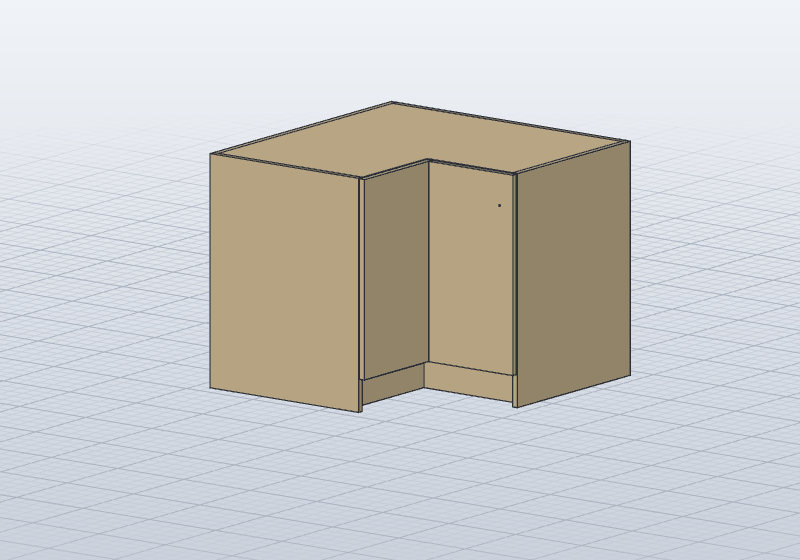 | 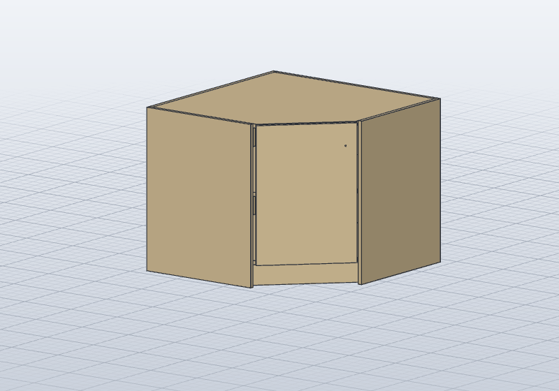 |
| *An L-shaped corner cabinet with a pair of folding doors.* | *A diagonal corner cabinet: one door across the corner.* |
| 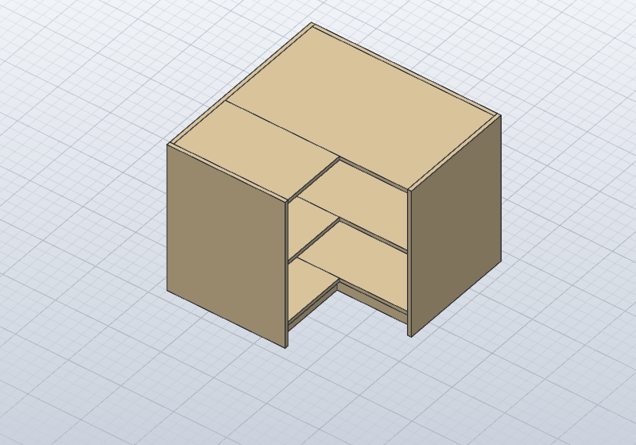 | |
| *Split boards: the L-shaped top, bottom and shelves in two dowelled pieces.* | |

Cabinet with **Shape** Corner, L-shaped or Corner, diagonal builds a cabinet for a corner of the room: bottom, top and shelves that fill the corner,
optional plinth, shelf pin holes, and doors hinged at the end you choose, with handle holes.
**Plinth / toe kick** (Yes or No) and the plinth of Woodwork settings work as on the box cabinet: a board set back from the fronts, the two end panels
notched at their front bottom corners, or legs under the corners of the footprint (six under the
L, the sixth in its inner corner; five under the diagonal) with the ends and backs standing on them.
**Casters** stand it on locking casters at the legs' places, but 50 mm in from the inside of
the ends and backs, each plate screwed into the bottom (with split boards the two at the
return's end into `Name Bottom return`).
It is parametric, takes a material, and can be placed, named and matched like the box cabinet.
Its doors have a **Reveal** (`Name_reveal`) as on the box cabinet, and **Fronts** (shown when
there are doors): Overlay, in front of the cabinet, or Inset, inside the opening with their faces
flush with the carcass front and the reveal from the end panels, bottom and top. Inset, the
shelves (not the bottom and top) stand a panel back behind the doors, and so do the shelf pin
rows. The L's pair is then the same bi-fold a panel back: the first door hinges on its front
edge just inside the end panel and runs into the inner corner behind the second, which folds
about the carcass's inner front corner. The diagonal door fills the opening between the two
ends; as the ends stand at 45 degrees to it, its edges stay the reveal clear of their inner
corners, which leaves a slanted strip of each end showing beside it. An inset front changes
nothing about where neighbouring cabinets stand.

**Wall mount**, **Cleat height** and **Cleat thickness** work as on the box cabinet (see
[Wall mount](#wall-mount)), along both walls: `Name Cleat` and `Name Wall cleat` along the back
wall, from the side wall to the back leg's end, and `Name Cleat return` and `Name Wall cleat
return` along the side wall behind the return's end, each bevelled towards the room; a hanging
rail is `Name Hanging rail` and `Name Hanging rail return`. With a cleat or a rail both backs
stand its thickness off the walls, between the bottom and the top, which reach the walls over
the boards; the shelves and the pin rows stop at the backs. A steel rail is one rail on each
wall (`Name_wall_rail`, the width, and `Name_wall_rail_return`, the return), two hangers each.
L-shaped and diagonal alike.

**Joinery** (from Woodwork settings: any method of the box cabinet but a dado, which takes
dowels here; Joinery inside is not used), with its sizes, works as on the box cabinet (see
[Joinery at build](#joinery-at-build)) on every joint of the carcass: the back's two ends into
the back leg's end and the back return, the back return's front end into the return's end,
and the bottom and top into the four upright boards round them. With a cleat or a hanging rail
the backs stand on the bottom and under the top, so those joints go up into the backs instead.
Split boards keep their two dowels at the joint between the two pieces (an edge joint the
other methods cannot make); each piece is joined to the boards it meets. L-shaped and
diagonal alike; Apply settings changes the method of those made.

**Corner** is the side the return is on. On Auto it is on the right when you place the
cabinet right of the selected one, as a run that ends in a corner needs it, and else on the
left.

Two shapes:

- **L-shaped**: two fronts at a right angle, with a bi-fold pair of doors. The first door is
  hinged on the cabinet and closes the inner corner; the second hangs on it there and folds
  out onto its face, so the two swing out together. The handle is on the second door, at the
  position you choose.

  **Bottom, top, shelves** (L-shaped only): **One piece** makes each an L cut from one board;
  **Split in two** makes each two rectangles, so a big corner nests on 2440 x 1220 mm sheets.
  The back leg's board runs the whole width (`Name Bottom`), and the return's board
  (`Name Bottom return`, `Name Top return`, `Name Shelf 1 return`) stands in front of it, the
  joint along the back leg's front edge. Two 8 mm dowel holes, 30 mm into each board, 40 mm in
  from each end of the joint, hold them together; the cut list counts them as `Dowel, 8 x 60
  mm`. An Edit keeps the choice.
- **Diagonal**: one front straight across the corner at 45 degrees, with one door. The depth
  at the end of the return follows from the width and the return, and equals Depth when the
  two are the same.

## Building a run: Place and Match selected

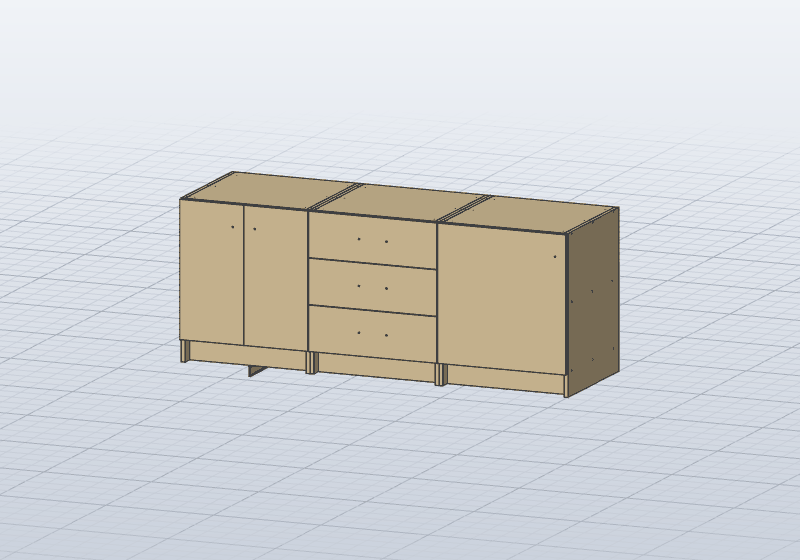

*A run: each cabinet placed against the side of the one picked.*

Select any part of a cabinet, then open **Cabinet**. The selection
shows in the dialog as **Selected cabinet**. Click that field and pick another board in the
model while the dialog is open, and the preview follows. Material and Drawing
have the same field.

**Match selected** shows only when a cabinet's board is picked, and then starts at Yes: the new
cabinet takes the picked one's height, depth, thickness and plinth, linked. While it is on, those four fields show the picked cabinet's values, greyed: change them on
that cabinet, or turn Match selected off. With nothing picked
it is hidden and not used. A script still says `match` (`selected` with nothing selected makes
the cabinet unmatched); one that leaves it out gets Yes when a cabinet is selected.

**Place** puts the new cabinet against the selected one, backs flush. That cabinet must
stand square to the axes.

| Place | Where the new cabinet goes |
|---|---|
| **Auto** (the dialog opens with it) | By the board you selected: left of a left side, right of a right side, above a top. At the origin with nothing, or any other board, selected. |
| **At the origin** | Centred on the origin. |
| **Right of selected**, **Left of selected** | Against that cabinet's right or left side, whichever way it stands. At the end of a corner cabinet's return the new one is turned a quarter and continues along the return, and the run carries on from there, corner cabinets too. |
| **Above selected** | On top of it. |
| **Along a line** | Its back on a line you pick: see [Along a line](#along-a-line). |

**A run stays together.** The new cabinet is held to its neighbour by a joint (`Name link`):

- Make a cabinet wider and the ones placed after it move along.
- Make one deeper and the backs stay flush.
- Make a corner cabinet wider, or its return longer, and the cabinets along the return move
  with it, their backs still on the wall.
- Make one higher and the one on top of it rises. A cabinet on top follows upwards only.
- The first cabinet of a run stands on its own middle, so it grows to both sides.
- To take a cabinet out of a run, delete its link.

**Match selected** links the new cabinet's height, depth, panel thickness and plinth (with its
set-back) to a **shared group** of parameters for the run, so the whole run is resized by changing
the group.

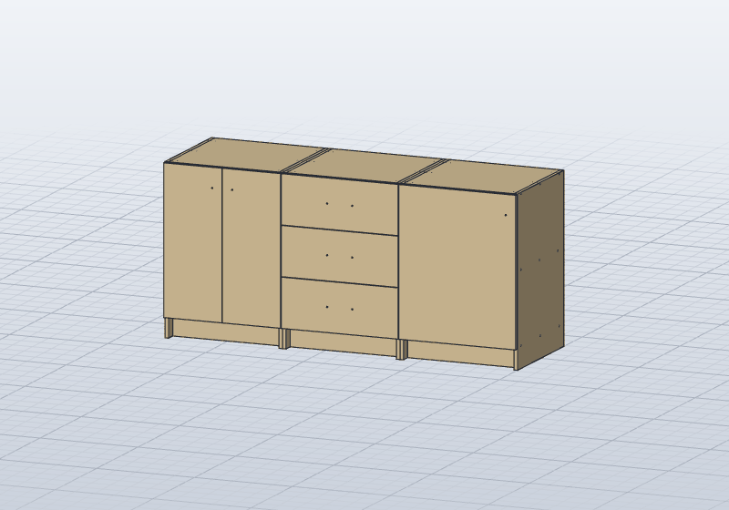

*A matched run: three cabinets sized by their shared group, Run_A_height set to 850 mm.*

- The first Match selected against a cabinet `A` makes the group, `Run_A_height`, `Run_A_depth`,
  `Run_A_thickness`, `Run_A_plinth` (and `Run_A_plinth_setback` when it has one), with A's
  expressions (one over A's own parameters, such as `A_height - 300 mm`, as its value, so the
  run never hangs on A), and points both A's and the new cabinet's parameters at it (`A_height = Run_A_height`,
  `B_height = Run_A_height`). Matching a cabinet that is already in a run joins that run: C
  matched to B points at `Run_A_height` too, not at B.
- **Change the run:** change `Run_A_height` in Parameters, and every cabinet in the run follows.
- **Take one cabinet out:** give its own parameter a value (`B_height = 700 mm` in Parameters,
  or a new height in Edit). Only that size leaves the run; the others stay in it.
- **Delete a cabinet:** the group's parameters are not any cabinet's, so deleting a cabinet, A
  included, and its parameters breaks none of the others.
- Woodwork settings and Apply settings change a cabinet's thickness and plinth like any of its
  sizes: a cabinet whose thickness or plinth they change leaves the run for that size.
- A design made before the groups keeps its links (`B_height = A_height`); the next Match
  selected against A makes A's run then, and B still follows A, which now follows the run.

### Along a line

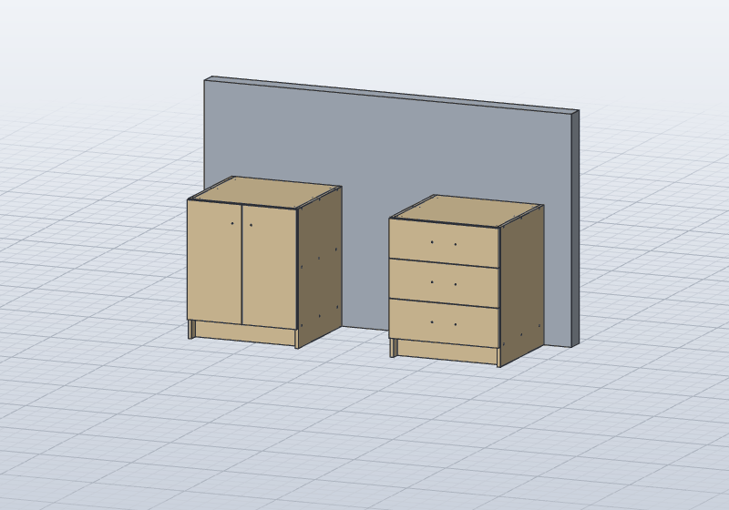

*Along a line: two cabinets against a wall's face, from its left and right ends.*

Model the room first, then put the cabinets against it. With **Place** on **Along a line**, click
the **Line** field and pick a line on the floor: a sketch line, an edge of a body (a wall's
bottom edge), or a wall's face, which stands for its bottom edge. The new cabinet stands with its
back on that line, at the line's height.

Quicker: select the line first, then open Cabinet. With a sketch line (or an edge of a body that
is not a cabinet's) selected, the dialog starts with **Place** on **Along a line** and that line in
the **Line** field (#212). A selected board of a cabinet still means Place Auto, beside it. Change
Place or Line and the dialog keeps your choice.

| Field | What it does |
|---|---|
| **Start at** | **Left end** (the default), **Right end** or **Middle** of the line, as seen from the front of the cabinet. |
| **Offset** | From that end to the cabinet's side, 0 by default. At the middle, how far right of the middle the cabinet's middle is (a negative offset moves it left). |
| **Faces** | **Away from the wall**: for an edge or a face, the cabinet faces away from the face; for a sketch line, it faces the rest of what is drawn in that sketch (the room), or -Y (-X for a line along Y) when the sketch has only the line. **Flip** turns it the other way. The preview shows which. |
| **Width from line** | The cabinet is as wide as the line, less the offset (at the middle, less the offset at each end). Width is then greyed. It does not go with **Size by** the drawers' inside, which works the width out from the boxes: pick one. |
| **Height from line** | Optional: pick a second line, a sketch line or an edge running any way, and the cabinet is as tall as it is long (plinth included), for example a line drawn up to the underside of a window. Leave it empty for the Height field. |

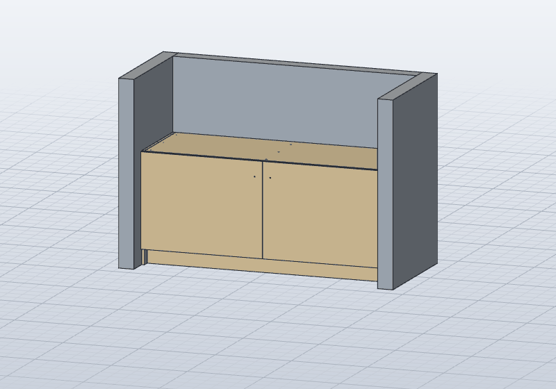

*Width from line: one cabinet fills the wall between two side walls.*

- **Quarter turns only:** the line must be level and run along X or Y. Any other line is
  refused, as Place, the worktop and the cut list read cabinets square to the axes.
- **It grows away from its start.** The cabinet's place follows its own sizes: made wider in
  Parameters (or by its line), its side at Start at stays where it is (both sides move out from
  the middle with Middle); made deeper, its back stays on the line.
- **A sketch line with a length dimension is followed at once.** With Width from line, the
  cabinet's `Name_width` parameter becomes that dimension (less the offset), and with Height from
  line `Name_height` becomes the height line's, so changing the dimension in the sketch, or in
  Parameters, resizes the cabinet with no rebuild. A dimension the app named (`d1`) is renamed
  after the sketch and the line first (`Wall_line_l1`).
- **Apply settings reads the lines again.** The cabinet remembers the lines it was placed by,
  and **Apply settings** builds it again from them: its width, height and place, so an edge or
  face of a wall, or a sketch line without a driving length dimension (or one only measured, a
  reference dimension), is followed by running Apply settings after changing it. A cabinet along
  a line is built again by every Apply settings run for that reason. A body's edges and faces
  are found again by their number on the body, so a change that renumbers them (a cut into the
  wall) can make it read another one: pick the line again then. A line that can't be read any
  more (deleted, suppressed, or no longer along X or Y) leaves the cabinet where it stands, and
  Apply settings' result says why under `lines`, beside what each cabinet along a line read.
  The summary of each Cabinet run says what follows what.
- **Edit keeps it on the line too.** A width or height typed in Edit is the cabinet's own from
  then on: that size no longer comes from its line.
- The dialog's first pick field is **Selected cabinet**, which takes what is selected when the
  dialog opens; the **Line** field starts empty, so click it before picking the line.

## Changing sizes

A cabinet's sizes are design parameters: `Name_width`, `Name_height`, `Name_depth`,
`Name_thickness` and so on. Change one in the Parameters table and the cabinet follows, its
doors' hinges included.

The counts (shelves, dividers, doors, drawers) are changed with an Edit.

## Edit a cabinet

Changes one cabinet after it is made: the Cabinet dialog with **Mode** on **Edit picked**, or on Auto with a door, front, shelf or
drawer of the cabinet picked. Select any part of the cabinet: the fields show that cabinet as it is, each field at its current value (the sizes as they are in Parameters), and
only the fields that apply show (no doors: no hinge side; no drawers: no drawer height or
Drawers at; no plinth: no plinth type). Change what should change; with nothing changed the
cabinet is not built again. The fields are the cabinet's own: width, height, depth (and a
corner's return), the kind (standard or sink base) or a corner's shape, doors and the side the
first door is hinged on, drawers, drawer front height and where the drawers go beside doors,
shelves, shelf pin holes, dividers, fronts (overlay or inset), handles and their position,
back, plinth (Yes keeps the cabinet's own plinth, or gives one the height of Woodwork
settings; No takes it away), plinth type, wall mount and labels. What is the same for the
whole design (joinery, hardware models, hinge opening, slide type, board thickness, reveal,
the plinth's height and set-back) is changed in [Woodwork settings](#woodwork-settings), then
Apply settings. Drawers added to a cabinet with doors go at the top unless Drawers at says
Bottom; an edit that takes the doors away from a cabinet with drawers makes the drawers all
alike again unless it gives another drawer front height. Name, Match selected, Place and what
only a new cabinet takes (units, board thickness, material, the drawer sizing) are hidden:
renaming would cut the cabinets matched to it loose.

A corner cabinet shows its doors, shape and return instead of the kind, dividers, doors,
hinge side, drawers and back. A cabinet made before Woodwork kept its values for Edit opens
with the dialog's defaults the first time: what you change is built, and a field left at its
default keeps the cabinet's value. From then on Edit shows the cabinet's values.

The cabinet is built again where it stands, under the same name. Its sizes stay as they are
in Parameters, its doors keep their material, its joinery is made again, and cabinets
matched to it still follow. Doors and drawers come back closed. Its end panels and fillers
are made again to fit it.

Works on cabinets made by 0.1.7 or later. A cabinet drilled by the Joinery function of
0.2.0 and before gets the same kind of joint at build (confirmat or dowels) when an Edit gives
it no method of its own; until then the cut list still counts its old holes.

## Material

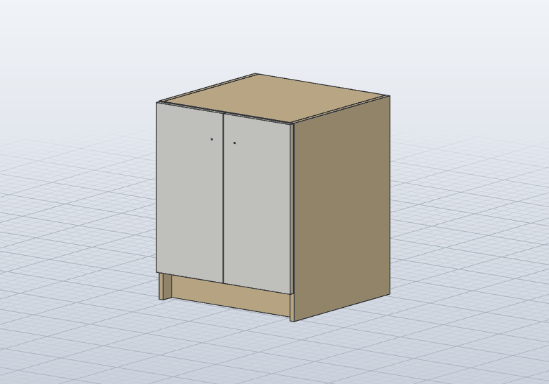

*Material: white melamine doors on a birch plywood cabinet.*

Gives the selected cabinet, or only the selected parts (the doors, say), a board material:
birch plywood, MDF, white melamine or oak. New cabinets get one in their dialog.

## Woodwork settings

Woodwork settings is a dialog per group: **General settings** (units, material, board
thickness, back, labels), **Fronts settings** (what doors and drawer fronts share: overlay or
inset, reveal, handle position, grip gap, front style and its sizes), **Doors settings**
(door handles, hinge opening, double dividers), **Drawer settings** (drawer handles and the
tab's width, box boards, box joints, front, slide type), **Plinth and wall mount settings**, **Joinery settings** (the methods and their sizes),
**Cut list and worktop settings**, and **Display settings** (hardware and fastener models,
see-through boards, camera). On the Model tab they are under one
**Woodwork settings** button: click it, or its arrow, and pick a group. Each is also in the
**Plugins > Woodwork** menu. A run of one changes only its own settings; the others keep what
is stored. Units is in General and is kept: the other dialogs give their sizes in it, and each
size's hint says which. A script runs the same entries (`woodwork.settings-general`,
`woodwork.settings-joinery`, ...), each with its own settings, its sizes in the stored units
(General sets them).

The defaults new cabinets start with in this design: material, panel thickness, reveal, handle
holes, plinth height and plinth type. Set the ones you want and run it; Keep or an empty field
leaves what is stored, and the result shows everything stored now. The Cabinet
dialog then opens with these values (the hint says "From Woodwork settings"), in the
dialog's own unit: a 19.05 mm thickness shows as 0.75 in when Units is Inches. You can still
change any field before Run. A script's `plugin.run` that leaves a field out gets the stored
value too.

It also holds what is the same for the whole design and is no field of the Cabinet
dialog: the back and its thickness, fronts (overlay or inset), **Double dividers**, handle position, the
plinth's height, type and set-back (a cabinet only says Yes or No), labels, a French cleat's
height and thickness; for the cut list the edge banding, the sizes it gives, the sheet size,
saw kerf and edge trim, and the **Prices** for its [cost estimate](#cost-estimate); for a new worktop its material and thickness (the overhangs stay in
the Worktop dialog: they differ from run to run); and the joinery (**Joinery**, **Joinery inside**, and the sizes of the method
chosen, shown only for it: **Joint spacing**, **Joint edge distance**, **Dowel diameter**,
**Dowel length**, **Dado depth**, **Biscuit size**, **Cam size**, **Cam bolt length**, **Pocket
face**, **Finger width**, **Finger-joint the bottom too**; see [Joinery at build](#joinery-at-build)) and the hardware (**Hardware models**,
**Hinge opening**: 95, 110 or 165 degrees, **Slide type**: partial, full, over-travel, dado runners, strip runners or undermount partial or full,
**Fastener models**; see [Hinges and slides](#hinges-and-slides)), **Drawer box joints** (none or finger joints) and **Drawer front** (separate or integrated with the box), and with strip runners **Strip thickness** and **Strip height**. The dialog starts at what is stored, or at the
defaults (dowels inside and out, 250 mm apart, 50 from the edges, 8 x 35 mm dowels, models
shown, 110 degrees, full extension). Every new cabinet takes them and remembers them: changing
them later leaves the cabinets made before as they are, and Apply settings gives them the
methods, the models, the hinge opening and the slide type stored. A corner cabinet takes the
carcass method (dowels for a dado). A script cannot give them to `woodwork.cabinet` (an unknown field is refused): it runs `woodwork.settings-joinery` first, such as
`{"joints": "confirmat", "joint_spacing": 300}`. A size that shows only with a choice needs the
choice in the same run (`joint_spacing` with `joints`, `back_thickness` with `back`,
`plinth_setback` with `plinth_type`).

- Changing the settings does not change the cabinets already made: Settings only stores them.
  **Apply settings** builds cabinets again with them (it was Settings' Apply to picked cabinets
  before).
- The settings are kept in the design (SolidCraft 0.46, `storage@0.1`), not for you as a user:
  a new design starts with none.
- **Camera after a run**: Fit (the default) frames the result after a cabinet, corner, edit or
  worktop run; Leave as it is keeps your view, for when you or a script set the camera. A
  script sets it with `woodwork.settings-display {"camera": "leave"}` (or `"fit"`).
- **See-through boards**: On makes the boards' materials (birch plywood, MDF, white melamine)
  see-through, 35 % opaque, so the joints, fasteners and hinges inside show; Off makes them
  solid again. It changes the materials when Settings runs (the preview shows it as you choose),
  and a material a later cabinet brings in is made the same way. Oak is built into SolidCraft
  and cannot be changed, so oak boards stay solid. It is only a look: the cut list and drawings
  are the same.
- Nothing is cleared: to go back to a default, set it to that value.
- The dialog does not remember the last values you used; only what Woodwork settings stored.

## Apply settings

Builds cabinets again with the Woodwork settings, where they stand (the same name, links, panels
and the materials of single parts you changed), as a long job: no 30 s limit, a row in the
operations panel with a bar that moves on per cabinet ("A (2 of 6)"), and Cancel, which leaves
the design as it was. A job has no Preview.

- **Cabinets**: a part of each cabinet to build again (any board, a hinge or slide model
  too); several parts of one cabinet count once. Empty: all box and corner cabinets in the
  design. The field's count is of parts; the note under it names the cabinets they are ("Applies
  to 3 cabinets: Base 1, Base 2, Wall 1") and any part that is no cabinet's. The dialog fills it
  with what is selected when it opens; a script passes the parts in `selection` (the design's
  selection is not used).
- **Build again**: **With the settings** gives each cabinet the design-wide settings stored now,
  taking only what that cabinet uses: a corner cabinet takes no drawer or inside settings.
  Material, thickness and reveal count only when they are stored. A cabinet that already has the
  settings is skipped. It never changes what you chose for a cabinet:
  - **Design-wide, applied:** board material and thickness, reveal, joinery and its sizes,
    hardware (models, hinge opening, slide type, fasteners), back, drawer and cleat thicknesses,
    and the plinth height and set-back (only on a cabinet with a plinth).
  - **Per cabinet with a default in Settings:** plinth Yes or No, plinth type, handles, handle
    position, fronts, back and labels. A cabinet that still has the default it was made with
    follows the new setting (all cabinets made on board plinths get legs); one with a value of
    its own keeps it (a wall cabinet made without a plinth keeps none). A choice made in Edit
    is the cabinet's own too: a cabinet edited to no plinth keeps none. A value set by hand that
    is the same as the default then counts as the default, and follows. A cabinet made before
    Woodwork 0.5.0 is taken as made with the built-in defaults.
  - **Per cabinet only, kept:** sizes, shape and kind, doors, drawers and where they are,
    shelves, shelf pins, dividers, door hinge side and wall mount.

  **As made** builds each with its own values and sizes from Parameters, for example after
  updating Woodwork.

The reply names the cabinets `applied`, what `changed` in each, and those `skipped` and why
(already has these settings, or not part of a cabinet).

## Panel

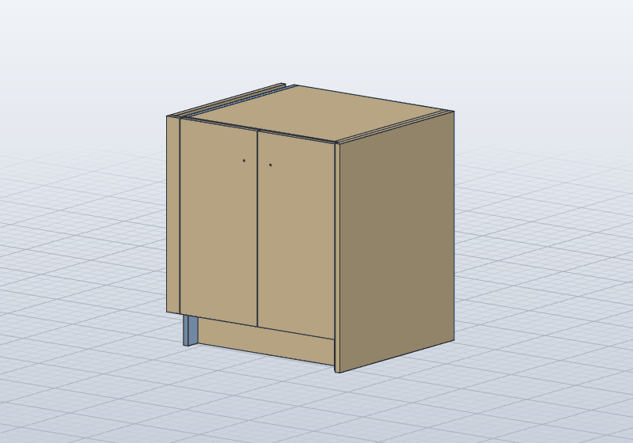

*Panel: an end panel on the right, a filler with its return on the left.*

Adds an end panel or a filler to one end of the selected box cabinet. It is part of the cabinet: it
follows its sizes, comes along when the cabinet moves, gets the material of its sides, and Edit
cabinet makes it again.

| Field | What it does |
|---|---|
| **Kind** | **End panel**: a full-height board outside the side, from the floor (covering the plinth) to the top, and from the back to the faces of the doors and drawer fronts (flush with the carcass when the fronts are inset or there are none). **Filler**: a strip of the filler width beside the cabinet, in the plane of the fronts and as high as they are, with a return behind its outer edge back to the wall. |
| **Side** | On Auto by the board you picked: its Side L or Side R. Left or right as seen from the front. |
| **Units** | The sizes in the dialog in mm or inches. Inches puts inch sizes in the fields you have not changed. |
| **Filler width** | Shown for a filler only: how far it reaches out from the cabinet, its thickness included. |
| **Thickness** | 0 for the cabinet's panel thickness (`Name_thickness`, so it follows it), or a thickness of its own. |

The boards are named `Name End panel L`, `Name Filler R` and `Name Filler R return`, each panel
in a folder of the history under its first board's name. One panel per side, and not on a side
where another cabinet stands against it. Not on corner cabinets.

To take a panel off, delete its folder in the history (with its features), not only the board:
An Edit then leaves it out. A cabinet placed on a side that carries a panel (Right or Left, or
the panel picked with Auto) stands beyond the panel, so a filler can go between two cabinets.
It is then not linked to the first: it does not follow when that one's width changes. A
drawing's width is over all, the panels included; its views take the panels in. On a cabinet turned a quarter (one placed past a
corner cabinet's return) a panel is not tested yet: check it lands at the side, or add it
before turning the cabinet.

## Mobile base

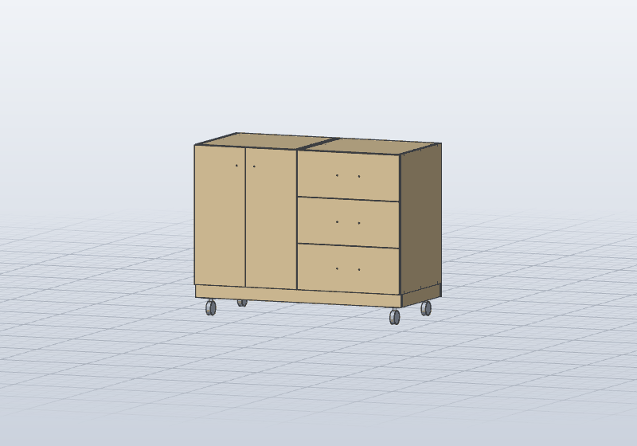

*A mobile base: one frame on locking casters under a run of two cabinets.*

For a workbench that rolls: pick a board of each cabinet and run **Mobile base**. It makes one
frame under all of them and stands them on it:

- **The frame:** boards on edge round the cabinets' joint footprint (seen from above, their sides
  and backs), `Name Frame front`, `back`, `left` and `right`, and a `Frame cross` board under each
  place where two cabinets meet, so every cabinet side stands on a board. A cross board along the
  frame (cabinets side by side across it, or back to back with different widths) runs only under
  the cabinets with that side and stops at the cross boards it meets, in pieces. **Stiffeners**
  (`Name Frame stiffener 1` and on) go across the frame too, evenly spaced, so no two boards across
  (the ends, the cross boards and the stiffeners) are more than **Stiffener spacing** (600 mm,
  300 to 2000) apart. **Frame height** (70 mm)
  is how tall they stand, **Board thickness** (18 mm) their thickness, **Material** theirs.
- **Timber:** **Frame of** Timber builds the same frame of solid softwood instead of boards, standing
  on edge: **Timber thickness** is the frame's thickness across, **Timber width** its height.
  48 x 98 mm by default; common sections are 48 x 98, 48 x 148 and 48 x 198 in Norway, and a US
  2x4 is 38 x 89 (2x6 38 x 140). The material is `Softwood timber`, which the cut list buys in
  running metres per section: each piece under *Timber, bought to length* and the metres of each
  section (`timber_metres`, and a Timber table in the CSV), laid out on no sheet, priced as
  `Timber 48x98` in the [cost estimate](#cost-estimate). The caster blocks are timber too: each is
  listed as a piece of its own size, noted `caster block`, out of the running metres.
- **Casters:** a block (`Name Block 1` and on, 90 x 90 mm) in each corner with a locking caster
  under it, screwed into the block; a longer frame gets more pairs, spaced evenly so the casters
  are at most 1500 mm apart along it (a block that would stand on a cross board moves beside it).
  **Caster height** (100 mm) is from the floor to the frame's underside.
- **The cabinets** go up onto the frame, each to its top (by Caster height plus Frame height
  from the floor). Make them with **Plinth** No: the frame is their plinth. A cabinet placed
  against another is held to it, so it goes up with it: pick the run's first cabinet too. One
  that would not end on the frame (held to a cabinet that is not picked) is refused, by name.
- **Made again:** run Mobile base with the same **Name** to make it again, for example after a
  cabinet got wider or with another frame height. With nothing picked it takes the cabinets it
  remembers, and they go up or down to the new frame's top.
- **Edit it like a cabinet:** pick a board, block or caster of the base and open **Mobile base**:
  the dialog starts at that base's values, and Name's hint says it is that base you edit. Pick
  more cabinets beside its board to add them: the base is made again under the cabinets it had
  and the new ones. (Taking a cabinet off a base is not offered yet.) A base made before this
  version opens so only after it has been made again once: run Mobile base by its Name.
- **A long job:** Mobile base runs as a job, with a row in the operations panel and Cancel, so a
  base under many cabinets (eight in a row and more) is made in one go. Its dialog has no
  Preview.
- **Held to the base** (#215): each cabinet standing on the frame that no neighbour holds gets a
  link to the base, `Name link`, like a cabinet placed on top of another. A cabinet placed beside
  another keeps its link to that one and rides along with it. An Edit or Apply settings puts the
  cabinet back on the base and links it again. A cabinet placed Along a line stays on the base
  on Edit: the line still sets its width and height, but the base holds where it stands. Apply
  settings, which reads the lines again, puts such cabinets back on their lines and makes their
  base again under them, so the base follows the line and the cabinets ride on it.
- **Following a resize:** the frame is made to fit the cabinets when it is made. After an Edit
  that changes a cabinet's width, depth, return or shape, the frame stays as it was, and Edit's
  reply says so: run Mobile base again by its Name, or Apply settings, which makes every base
  under the cabinets it looks at again (also when it has nothing else to change), so the frame
  fits them again.
- **Connector bolts** join the cabinets: where a side of one touches a side of another, four
  9 mm holes (for M6 connector bolts) go through both, at a quarter and three quarters of where
  they touch, across and up. Run again, a hole already there is not cut twice. An Edit of a
  cabinet makes its side whole again: run Mobile base again afterwards.
- **Frame screws** fix the cabinets to the frame: where a cabinet's bottom rests on a frame board
  for at least 100 mm, two 4.5 mm holes (for 4 x 50 mm screws) go down through the bottom onto the
  board's middle, at a quarter and three quarters of that length. A run again does not cut them
  twice, one with other frame sizes moves them, and an Edit of the cabinet drops them until Mobile base runs again.
  A cabinet with a plinth does not rest its bottom on the frame and gets none.
- The cut list lists the frame's boards and blocks, and counts the casters as `Caster, locking`,
  the bolts as `Connector bolt, M6` and the screws as `Frame screw, 4 x 50 mm`.

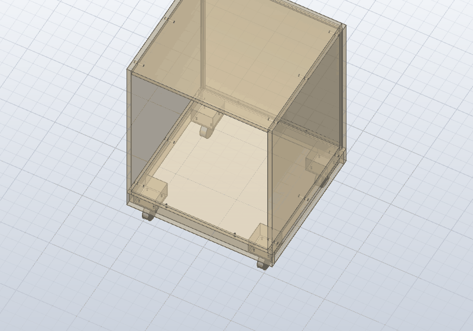

*Frame screws: two holes down through the cabinet's bottom into each frame board under it, seen through the boards.*

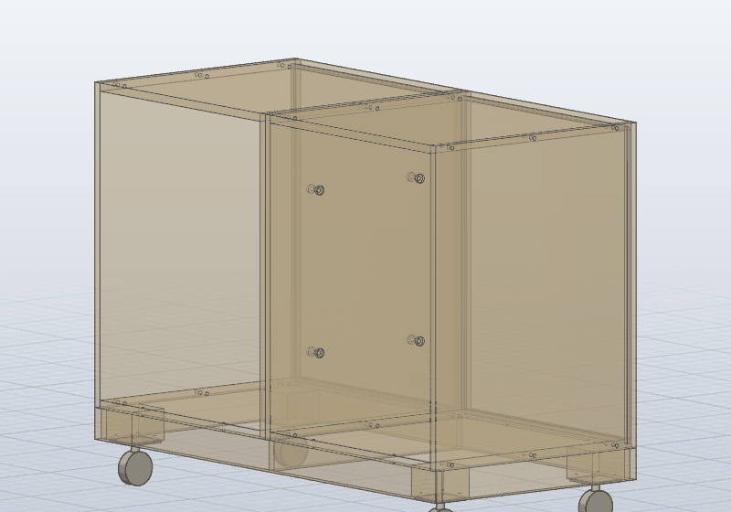

*Connector bolts: four 9 mm holes through the touching sides of two cabinets on a base, seen through the boards.*

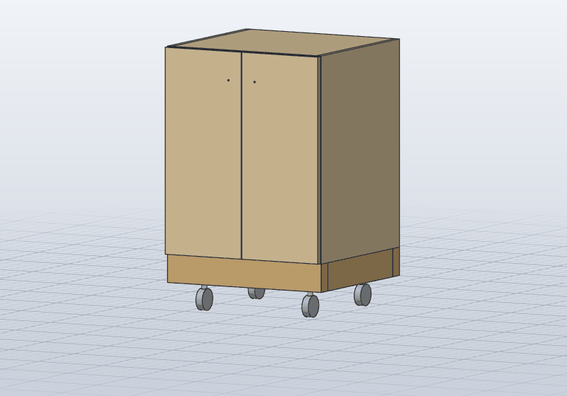

*A mobile base of 48 x 98 mm timber under a cabinet, bought in running metres.*

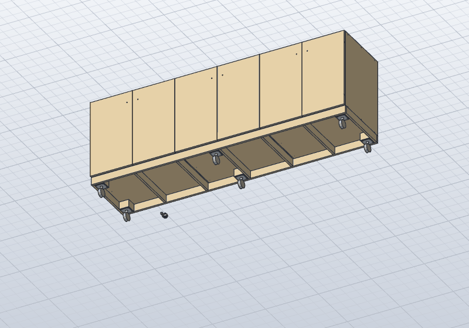

*A long base seen from below: stiffeners across the frame and casters spaced evenly between the corners.*

Its sizes are in mm. It is numeric, like the worktop: it does not follow a cabinet that changes size until it is made
again (Mobile base by its Name, or Apply settings). Quarter turns only, and in a component that
stands on the origin. Not in it yet ([#198](https://github.com/TomasDJo/solidcraft-woodwork/issues/198)):
a worktop height that sets a tool cabinet's height.

## Worktop

| | |
|---|---|
| 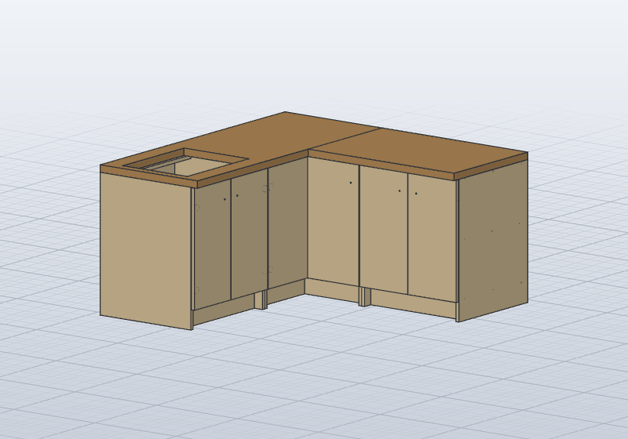 | 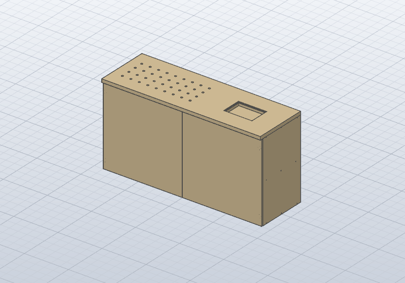 |
| *Worktop over a corner, a sink base and a cabinet, with a sink cut-out.* | *A bench top with a zone of dog holes and a rebated cut-out.* |

Lays a worktop over the selected cabinets. Pick a board of each cabinet (the **Selected cabinets**
field takes several): one straight run, or runs that meet in corners, such as an L or a U round
corner cabinets. A gap between cabinets, for a dishwasher or an oven, is covered by the same
piece. Every cabinet must have its top at the same height and stand square to the walls.

| Field | What it does |
|---|---|
| **Units** | The sizes in the dialog in mm or inches. Inches puts inch sizes in the fields you have not changed. |
| **Corner joint** | **Butt**: the longer run's piece goes through to the wall, the other stops against its front edge. **Mitre**: both go to the walls and are cut on the line from the inside corner to the outside one (45 degrees when both are equally deep). |
| **Thickness** | In Woodwork settings (Worktop thickness), 38 mm by default. |
| **Front overhang** | Past the front of the deepest cabinet of the run (doors stand about 20 mm proud). The back is flush with the wall. |
| **Left end overhang**, **Right end overhang** | Past a free end of a run, left and right as seen from its front. In an L that is the left run's left end and the right run's right end. |
| **Dog holes** | 20 mm holes through the first piece on a 96 mm grid, for bench dogs: **All over** (centred, at least 60 mm from the edges) or **In a zone** (Zone from left, Zone from front, Zone length, Zone width, measured from the piece's left end and front edge; the grid is centred in it). |
| **Cut-out** | An opening through the first piece: **Plain**, or **Rebated** with a shallow ledge all round at the top (Ledge width and Ledge depth), so a router plate or a sink rim sits flush. Opening length and width, and its middle from the piece's left end and front edge. |
| **Tool** | **Benchtop tool, flush**: an opening in the first piece for a table saw, mitre saw, planer or router table, which stands on a shelf inside the cabinet below so its table is flush with the top. Tool width (along the piece) and Tool depth are the tool's outline where it passes through the top (its table if that is wider than its base); Tool height is from where it stands to its table; Tool from left and Tool from front put its middle, as for the cut-out; Tool clearance is the gap all round in the opening (3 mm). |
| **Material** | In Woodwork settings (Worktop material), oak by default. A worktop made again keeps what it was made with. |
| **Name** | One piece is named `Worktop`; more are `Worktop 1`, `Worktop 2`, the longest first. |

The worktop is a component of its own on the origin, grounded, with no parameters: it is measured
from the cabinets as they stand. It does not follow when a cabinet changes; **run Worktop again**
(with only a piece of it picked, or with nothing picked and its name) and it is made again as it
was, over the same cabinets, with its name and options kept, replacing the old one. To change its
options, pick its cabinets (a worktop piece too, if you like) and give its name: it is made again
with the dialog's values. A diagonal corner cabinet
gets the same square L as an L-shaped one. Dog holes and the cut-out go into the first piece, the
longest; one that does not fit on it is refused. Two runs facing the same way along different
walls, or facing each other, are two worktops: make each with its own name.

A name with `Worktop` in it is bought to length in the cut list. Named otherwise, such as `Bench
top` in birch plywood, it is a board laid out on the sheets like any other.

### Tool station

With **Tool** on Benchtop, the first piece gets an opening the tool's size plus the clearance all
round (`Worktop tool opening`), and the cabinet under it a shelf, `Worktop Tool shelf`, 18 mm birch
plywood between the sides' inner faces, from the back's front face to the sides' front edge, its
top the tool's height under the worktop's surface. It rests on two 18 x 40 mm battens, `Worktop
Tool batten L` and `R`, screwed to the sides under it. The opening must lie between the two sides
of one cabinet (a corner cabinet does not count); a tool shorter than the worktop is thick, or so
tall that the battens would be below the cabinet's bottom, is refused. The shelf and battens are
boards in the cut list (laid out on the sheets, not bought to length), and are made again with
the worktop.

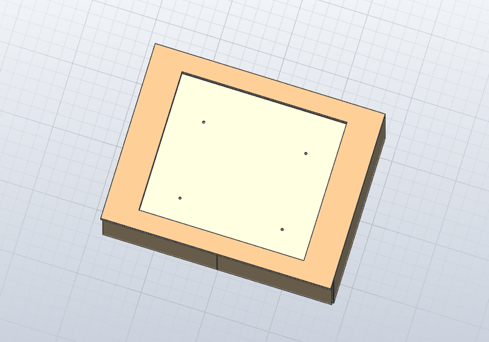

*Bolt holes for the tool's feet: four 8 mm holes through the tool's shelf, seen through the opening.*

**Bolt spacing across** and **Bolt spacing front to back** drill the shelf for the bolts that
hold the tool down: four 8 mm holes (for M6 bolts, with some play) at the corners of that
rectangle, centred on the tool's middle (**Tool from left** and **Tool from front**). Measure
between the tool's feet, centre to centre. With one spacing 0 you get a pair; with both 0 (the
default) no holes. A hole off the shelf is refused.

The cabinet's top, or a sink base's rails, gets the same opening, so the tool drops through.
Anything else of the cabinet between the tool's shelf and the worktop, or where the shelf and
its battens go, such as a shelf, a divider, a drawer or a door the opening reaches over, is
refused by name: make the cabinet without it (with 20 mm doors and a 40 mm front overhang, keep
the opening's front edge at least 40 mm from the worktop's front). So is an opening that
reaches over the cabinet's back. The opening in the cabinet's top is a cut the cabinet does not
remember: an Edit makes its top whole again (run Worktop again afterwards), and a tool
moved on a run again leaves the old opening in the top.

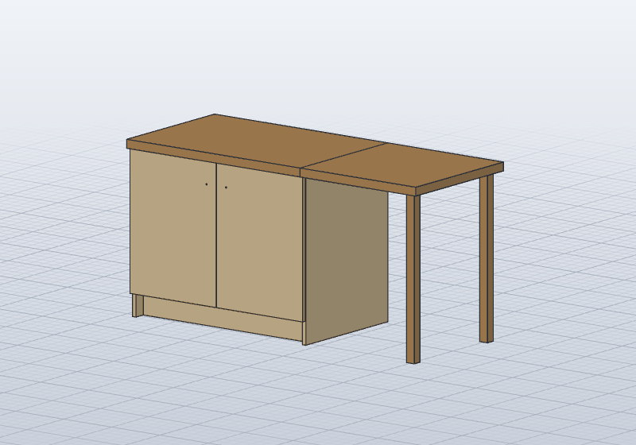

*A side wing: the worktop carried on 600 mm past the run's right end, on two legs.*

**Side wing** (Left end or Right end) carries the worktop on past that end of the run, as deep
and as thick, **Wing length** long, for long stock beside a tool such as a mitre saw. It stands
on two 40 mm square legs at its free end, from the floor the cabinets stand on (or their legs) to
its underside. The wing is `<Name> Wing`, bought to length with the worktop; its legs are
`<Name> Wing Leg 1` and `2` and count as legs in the cut list's hardware. It goes on the first
piece's end, which must be square (not mitred into a corner). It is made again with the
worktop. A fold-down wing is not made (#172).

## Cut list

Returns every board as length x width x thickness with quantities, and as CSV. In a design
set to inches or feet it lists inches as fractions to 1/32. It also:

- lays the parts out on sheets per material and thickness, and counts the sheets to buy from
  those layouts (see [Cutting layouts](#cutting-layouts));
- counts the hardware: hinges, drawer slides, shelf pins, screws or dowels, adjustable legs, casters, handles,
  steel wall rails (to length) and cabinet hangers;
- gives a notched side (Plinth type Notched sides) its size over the notch, on a line of its own
  marked `notched for the toe kick; size over the notch` (in the PDF too, and `notched` on its
  label); the cutting layouts and DXF give it as that rectangle, so saw the notch yourself;
- marks the edges to band, as OpenCutList does: `L2 W2` is both edges along the length and both
  along the width, `L1` one edge along the length. Doors and drawer fronts (a sink base's false
  front too) are banded all round; sides, top, bottom, shelves, the rail between drawers and doors, a sink base's front
  rail, dividers and fillers at the front; end panels at the front and on top (`L1 W1`); backs,
  plinths, a sink base's back rail, filler returns and drawer boxes not. It adds up the metres of banding per
  material and thickness, plus 10 % waste;
- lists a board of a material with a grain (Birch plywood, Oak) with its length along the
  grain, marked `grain`: up on sides, doors, backs, dividers, drawer fronts, end panels, fillers and their
  returns, along the
  cabinet's width on top, bottom, shelves and drawer bottoms, and along the drawer box's
  sides, front and back. Such a part must not be turned on the sheet. Other materials (MDF,
  White melamine) have the longest side as the length, and so do plinths and the drawer
  box's sides, front and back;
- warns of doors that hit another cabinet's front (`clashes`, and a `Clash` line in the CSV):
  a door hinged on its cabinet's side swings past 90 degrees (every hinge opening does) in
  front of the next cabinet, so a door or drawer front (an integrated one too) right beside its hinge edge meets it
  when both are open, such as "A Door (open) meets B Drawer 1 Front (open)". Hinge the door on
  its other side, or put a filler between. Box cabinets standing in quarter turns, with their
  doors and fronts shut in the design. Each door already turns about its front edge on the
  hinge side, which is where a concealed hinge's swing ends up, so open doors stand where real
  ones do.

In Woodwork settings, for the whole design: **Edge banding**, the tape's thickness: none, 0.4, 1 (the default) or 2 mm. **Sizes**
(shown when there is banding): finished, as in the model, or cut, the size to saw: the finished
size less the tape on each banded edge. The list says which it shows.

Fill in **Save as** with a name to also get the list as a file, in the **Format** chosen
(it shows once there is a name, and **Cutting diagrams** with PDF):
PDF, a printable A4 list with a tick box per board and per piece of hardware, one table per
material and thickness, the sheets to buy and the cutting diagrams; CSV, for a spreadsheet; or
Labels (PDF), a sticker per board to stick on after cutting (see [Part labels](#part-labels)); or
DXF, a drawing per sheet for a CNC router or CAD program (see [DXF](#dxf)). It goes into the folder for cut
lists that SolidCraft asks you for when you install the plugin; without such a folder, leave
the field empty.

### Cost estimate

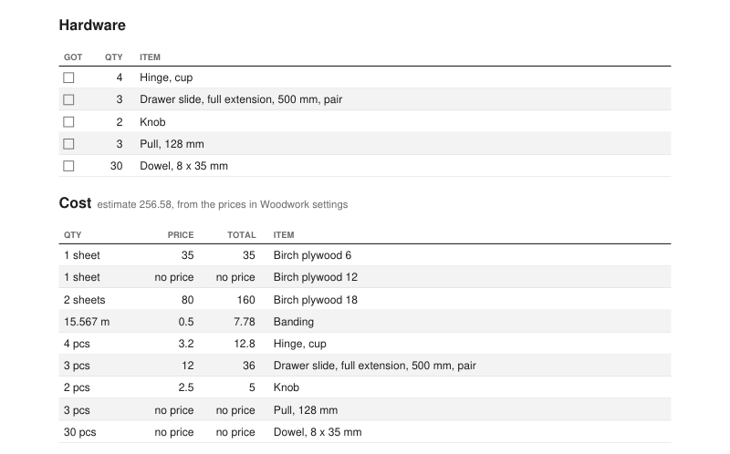

*The cut list's PDF with a cost estimate from the prices in Woodwork settings.*

Give your prices in **Woodwork settings** (Cut list and worktop settings), in **Prices**, as
`name = price` entries separated by `;`:

    Birch plywood 18 = 80; Birch plywood 6 = 35; Banding = 0.5; Hinge = 3.2; Drawer slide = 12

- **A sheet** is priced per sheet, by its material and thickness in mm, as the sheets to buy
  name it: `White melamine 18` and `White melamine 6` are two prices.
- **Banding** is one price a metre, for the metres the list adds up (waste included).
- **Timber** (a mobile base's timber frame) is priced per running metre of its section,
  thickness by width in mm: `Timber 48x98 = 3.5` (or `Timber 48 x 98`).
- **Hardware** is priced a piece. The entry whose name an item starts with prices it, the
  longest one if several do: `Hinge` prices every hinge line, and `Drawer slide, full extension`
  goes before `Drawer slide`. Upper or lower case doesn't matter.
- The numbers have no currency: the estimate is in whatever you gave them in. A decimal comma
  works too (`3,2`).

The cut list then adds `cost` to its reply: a line for each sheet, the banding and each piece
of hardware with its quantity, unit (`sheet` for one, `sheets` for more, `m`, `pcs`), price and total, the `total` of what has a price, and `missing`: an entry
for each line that has none yet, such as `Birch plywood 12 = ?`, ready to fill in and copy into
Prices. So the first run, with Prices empty, lists every price the design needs. With Prices
filled in, the PDF has a **Cost** table after the hardware (a line without a price says so), and
the CSV a Cost section with the total and the lines still without a price. Worktops, bought to
length, and a timber base's caster blocks are not priced.

### Cutting layouts

The parts are laid out on sheets of the **Sheet size** chosen (2440 x 1220, the default,
2500 x 1250, 2800 x 2070 or 3050 x 1530 mm), with the **Saw kerf** (4 mm) left between parts
and the **Edge trim** (10 mm) cut off every edge of the sheet. Each layout can be cut on a panel
saw: every cut runs right across the piece it is made in. A part of a material with a grain
keeps its length along the sheet's length; any other part may be turned. Parts are laid out at
the size the list shows, so at the cut size when **Sizes** is Cut. A corner cabinet's one-piece L-shaped bottom, top and shelves take their whole square, as they are cut on a panel saw, but the PDF's diagrams and the DXF draw their real L outline, the open corner at the part's far corner (turn or flip the board to match): it is cut out with a jigsaw or track saw afterwards, and nothing else is laid out there. An L board bigger than the sheet stays in the oversize list; Split in two makes it fit. The diagonal corner's boards are drawn whole. A part that is too big for
the sheet less its trim (or fits only with its grain across the sheet) is not laid out: the
reply lists it under `oversize` with the reason, and the PDF names it under the sheets to buy.
Sheet sizes, kerf and trim are metric mm: a 4 x 8 ft sheet is 2438.4 x 1219.2 mm, so pick
2440 x 1220 and leave the trim on.

A board whose name contains `Worktop` (made by Worktop, or drawn yourself) is not sheet stock: it
is left out of the layouts and the sheets, and listed as bought to length (the reply's `worktops`, and a table "Worktops,
bought to length" in the PDF), at its bounding box, also when mitred or cut out. It still appears in the cut list's rows.

The layouts are a quick greedy fit, not an optimiser: a few orders and two ways of choosing
the free piece are tried and the one with the fewest sheets kept. A cutting program may well
save a sheet on a big job.

**Cutting diagrams** (Yes, the default, or No) adds a drawing of each sheet to the PDF, after
the tables: per material and thickness a legend numbering the parts as rows of the list (equal
parts share a number), then each sheet with its parts outlined and numbered with their size
(the number only on a small part), the offcuts grey and the trim dashed. Each sheet's heading
gives the material, thickness, sheet n of m and its yield, the share of the sheet that becomes
parts.

### Part labels

**Format** Labels (PDF) saves `<name>.pdf` with one label per board (a part of quantity 2 gets
two), on A4 sheets of 3 x 8 labels of 70 x 37 mm without margins (Herma or Avery 3474), with
thin lines where the labels meet. Each label has the board's name, its size (length x width x
thickness, as the list shows it), its material, its number and sheet in the cutting diagrams
(`#12, sheet 3 of 5`, sheets counted per material and thickness), and a small drawing of the
part, length across: its banded edges thick (named too, `edges L1`) and an arrow along the
length when it has a grain. The labels follow the cutting diagrams sheet by sheet, so a
sheet's parts come off it in label order; boards on no sheet come last, marked "bought to
length" (worktops) or "not on a sheet" (too big). A long name is set smaller, down to 7 pt,
then cut short with `...`.

### DXF

**Format** DXF saves one file per sheet of the cutting layouts, `<name>-<material>-<thickness>-<n>.dxf`
(`kitchen-White melamine-18-3.dxf`, n counting the sheets of each material and thickness from 1),
and the reply's `saved` lists them all. Each is an ASCII DXF R12 with every size in mm, x along the sheet's
length and y across it, as the cutting diagrams, on these layers:

- `SHEET`: the sheet's outline, and the edge trim inside it
- `OUTLINE`: each part's rectangle, where it lies on the sheet
- `TEXT`: each part's name in its middle, along its longer side
- `DRILL_<diameter>_D<depth>`, or `DRILL_<diameter>_THRU` for a hole right through: the holes
  drilled into the part's face, in mm to 0.1 with a `P` for the decimal point (`DRILL_5_D12`
  shelf pins, `DRILL_35_D13` hinge cups, `DRILL_5_THRU` handle screws, `DRILL_4P5_D10P9`). A hole drilled from the other face than the one drawn is
  on the same layer with `_BACK` added. Each part is drawn from the face with the most holes.

The holes are read from the model, one command per drilled board (about 60 in the sample
kitchen). Limits: a hole drilled into an edge (confirmat pilot, dowel into a board's end) cannot
be drawn on a sheet and is only counted, in the reply's `dxf_edge_holes`; grooves (the back
panel's) are not drawn; at Cut sizes a hole is placed from the part's middle, so up to half the
banding (1 mm) off toward a banded edge; a square or nearly square part may get its holes
turned a quarter against its grain, as its length is told from its width by size. A design with more drilled boards than a run's 256
commands allow gets outlines only for the rest, named in `dxf_holes_skipped`. A sketch's
**Insert DXF** reads the files back.

For scripts the reply has, beside the rows (a notched side's row also has `note`): `sheets` per material and thickness (`area_m2`,
`sheets` to buy, `yield_pct`), `sheet_mm` (length and width), `kerf_mm`, `trim_mm`,
`layouts` (one per sheet: `material`, `thickness`, `size`, `yield_pct` and `parts`, each with
`part`, `row` (its row in `parts`, from 0), `x`, `y`, `w`, `h` and `rotated`; x along the
sheet's length from its corner; when saving DXF also `holes`, each `[x, y, diameter, depth or
null, back]` on the sheet), `oversize` (`part`, `material`, `thickness`, `length`, `width`
in mm and `reason`) and `worktops` (`part`, `material`, `thickness`, `length`, `width` as the
list shows them). Layouts are always in mm (`layout_units`), also in a design in inches.

## Drawing

Draws the selected cabinet, or every cabinet (**Draw: Every cabinet**), on a sheet of its own in
the design's drawing **Woodwork**, which it makes the first time. A sheet is A3 landscape and is
named after the cabinet; drawing a cabinet again replaces its sheet, and the other sheets stay.
Each sheet has:

- the cabinet's front view with the right view beside it on the left of the sheet, and an iso view
  on the right between the board list and the title block, each at the largest scale that fits
  there (1:1, 1:2, 1:4, 1:5, 1:8, 1:10, 1:15, 1:20, 1:25 or 1:50; the iso view may have its own),
  with its doors and drawers closed whatever they are in the model;
- its width and height on the front view and its depth on the right view, in mm, measured on the
  sides (and the back where it stands out behind them; on legs the height is the carcass's, above
  them); the views and sizes follow a change of the
  cabinet's parameters, the board list does not (draw it again);
- its boards, grouped by size as in the cut list (quantity, part, length x width x thickness,
  material), at the top right; a list longer than the room above the title block ends with a line
  that sends you to the cut list;
- the cabinet's name in the title block (not its material and mass: working them out made
  opening the drawing slow; the board list names each board's material).

The drawing is with the design's drawings; print or export it from there. A turned cabinet (a
quarter turn) is drawn from its own front.

- **A corner cabinet gets no dimensions**, only its views and boards, seen from the side of its
  open corner, and its iso view looks into that corner (from the front left for a right corner).
- **The board list is text, not the drawing's parts list.** A parts list counts components, and a
  cabinet's boards are bodies of one component, so it would only list the doors and drawers.
- **Every cabinet draws only the sheets that changed**: a cabinet whose sheet would come out the
  same (not edited, resized or moved since) keeps it. Selected cabinet always draws it again.
- **A big design can take more than one run**: a run may take 30 s and 256 commands, so Every
  cabinet stops starting sheets after about 20 s (a sheet takes 12 commands) and answers with the
  sheets drawn and those left, such as "Drew 6 of 13 sheets; run Drawing again for the rest". Run it
  again until none are left: each run carries on where the last one stopped.
- **Draw a cabinet again after an Edit**: Edit builds the cabinet anew, and the old sheet's
  views go blank and its sizes are lost. A deleted cabinet's sheet stays until you delete it.
- The drawing is in mm also in a design in inches.

## Good to know

- **After a cabinet is added or edited the view shows the whole model** (SolidCraft 0.45), and
  nothing is selected: pick the board to place the next cabinet against.
- **An AI agent can use every function as a tool** (SolidCraft 0.45): `woodwork.cabinet`
  (corner cabinets too, by its `shape`), `woodwork.edit` and so on, with the dialog's fields as its arguments. Every field
  with a default is required there, so the agent sends them all, the defaults with what it wants changed; a
  field the dialog would hide is left out. From SolidCraft 0.46 the same check applies to a
  script's `plugin.run` and `woodwork.<entry>` (except Material and Drawing): pass
  every field the dialog would show. Cabinet is the exception (0.46,
  Woodwork settings): a field left out takes the stored setting, and only then must every
  field be there. The joinery and hardware are no fields of theirs at all: set them with
  the settings' section entries (`woodwork.settings-joinery`, ...) first.
- **A cabinet made by 0.1.7 or earlier** in a run is held along the run only: its neighbours
  do not follow its depth.
- **A design made with the plugin is ordinary bodies, joints and parameters.** It opens in
  any SolidCraft from 0.41 on, with or without the plugin.
