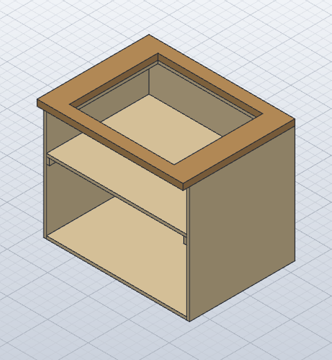

# Using Woodwork

The functions are under **Plugins > Woodwork** and as buttons on the ribbon. Each opens a
dialog; the cabinet you are about to make is previewed in the model before you press Run.
A dialog shows only the fields that apply to your choices (SolidCraft 0.46): the door fields
appear when there are doors, the reveal and handles when there are doors or drawers, the drawer
front height when there are two or more drawers or drawers with doors, and where they go when there are doors too, the back's
thickness when there is a back, and a sink base has no shelf or divider fields, and drawers only
without doors.

- [Cabinet](#cabinet)
- [Corner cabinet](#corner-cabinet)
- [Frame](#frame)
- [Building a run: Place and Match selected](#building-a-run-place-and-match-selected)
- [Changing sizes](#changing-sizes)
- [Edit cabinet](#edit-cabinet)
- [Joinery](#joinery)
- [Material](#material)
- [Panel](#panel)
- [Worktop](#worktop)
- [Cut list](#cut-list)
- [Drawing](#drawing)
- [Good to know](#good-to-know)

## Cabinet

Builds a box carcass: sides, top, bottom, shelves, back and optional plinth. Each panel is an
ordinary named body. The cabinet stands on Z = 0, centred on the origin, and is a component
of its own inside whichever component is active, so it moves as one piece and a room
component can hold its cabinets.

| Field | What it does |
|---|---|
| **Kind** | Standard or a sink base: see [Sink base](#sink-base). |
| **Units** | The sizes in the dialog in mm or inches. Inches puts inch sizes in the fields you have not changed. |
| **Width, Height, Depth, Panel thickness** | The outside sizes. Height includes the plinth. |
| **Back**, **Back thickness** | In a groove, overlaid on the rear edges, or none. |
| **Wall mount**, **Cleat height**, **Cleat thickness** | How the cabinet hangs on the wall: none, a French cleat, a hanging rail or a steel rail. See [Wall mount](#wall-mount). |
| **Joinery**, **Joinery inside**, **Joint spacing**, **Joint edge distance**, **Dowel diameter**, **Dowel length**, **Dado depth**, **Biscuit size**, **Cam size**, **Cam bolt length**, **Pocket face** | How the sides are fixed to the bottom and top, and (Joinery inside, shown with dividers or a rail) the dividers and the rail: dowels (the default), confirmat screws, screws, cam locks, pocket screws, biscuits, a dado or none. See [Joinery at build](#joinery-at-build). |
| **Dividers** | Vertical dividers, splitting the inside into equal compartments, each with the same shelves. |
| **Shelves** | Shelves in each compartment, evenly spaced. |
| **Drawers** | Drawers with fronts and boxes sized for 12.7 mm ball-bearing slides, drilled for them (see [Hinges and slides](#hinges-and-slides)). Alone they fill the front and the cabinet has no shelves. With one or two doors they sit above or below the doors (**Drawers at**), with a fixed rail (`Name Rail`) between the sides behind the gap between the drawers and the doors, and the shelves on the doors' side of it; with inset fronts the rail stands a panel back, behind them. Not with dividers. |
| **Drawer front height** | With doors: the height of each drawer front, 0 for 150 mm. Drawers only: the top drawer's front, and the others share what is left equally (a lower top drawer, deeper ones below); 0 makes them all alike. In the dialog's units. Once used it is the design parameter `Name_drawer_height`: change it in Parameters and the fronts, doors and rail follow. Going back to all alike (or 150 mm) is done with Edit cabinet, not by setting the parameter to 0. |
| **Drawers at** | With doors too: Top puts the drawers at the top and the doors below them, Bottom the drawers at the bottom on the plinth and the doors above. |
| **Plinth height** | 0 for none. |
| **Plinth type** | Shown with a plinth. **Board**: a board under the cabinet, Plinth set-back from the front (`Name Plinth`). **Notched sides**: no board; each side has a toe kick Plinth set-back deep cut out of its front bottom corner, as high as the plinth, and the bottom sits on top of it, so you can fit one long plinth board along a whole run yourself (the cut list gives a notched side's size over the notch and says so). **Legs**: no board; the whole carcass stands on adjustable legs as high as the plinth (`Name Leg 1` and on, 40 mm round, 50 mm in from the edges: four, six on a cabinet over 900 mm wide), which the cut list counts as hardware and leaves out of the boards. An end panel still reaches the floor. **Casters**: the same, on locking casters so the cabinet rolls (`Name Caster 1` and on: an 80 mm plate under the bottom and a wheel, at the legs' places but 50 mm in from the inside of the sides; four 4 mm pilot holes for each plate in the bottom panel, 60 mm apart). Needs a plinth of at least 50 mm, counted as "Caster, locking" in the cut list's hardware; an end panel stops at the cabinet's bottom. Corner cabinets too. |
| **Plinth set-back** | Shown with a Board or Notched sides plinth: how far the board, or the notch, is back from the front. 50 mm (2 in) by default, 0 to 200, less than the depth less a panel. The parameter `Name_plinth_setback`. |
| **Shelf pin holes** | 32 mm system rows of 5 mm holes; the shelves rest on them. |
| **Doors** | Doors with 35 mm hinge cup holes, and the hinge plates' screw holes in the sides: one, two, or one per compartment. |
| **First door hinged** | The side the first door is hinged on. The next ones alternate, and two doors always open from the middle. |
| **Fronts** | Overlay: the doors and drawer fronts cover the carcass edges. Inset: they sit inside the opening between the panels, their faces flush with the carcass front; the shelves, dividers and drawer boxes stand back behind them. Inset doors in a cabinet with one door per compartment each fill their own compartment. |
| **Reveal** | The gap around and between the fronts, 0.5 to 6 mm (2 by default), always in mm, also on an inch cabinet. Overlay: also how far the fronts stop short of the carcass's outside edges. Inset: the gap all round inside the opening. On a cabinet with doors or drawers it is the design parameter `Name_reveal`: change it in Parameters and the fronts follow. |
| **Handle holes** | Drills the doors and drawer fronts for a knob (one 5 mm hole) or a pull (two, 128 mm apart). |
| **Handle position** | Near the top, in the middle or near the bottom of a door. On Auto: near the top on a floor unit, near the bottom on a wall unit. On a drawer front the handle lies across: in the middle on Auto, or 40 mm from the front's top or bottom edge. |
| **Labels** | Writes each board's name on it, the name the cut list has, as text in a sketch on the board's face. It stays in the middle of the board when the cabinet changes size. |
| **Selected cabinet**, **Match selected**, **Place** | See [Building a run](#building-a-run-place-and-match-selected). |
| **Material** | The board material of every panel. Change it later with [Material](#material). |
| **Name** | The prefix of the panel names. A name that is taken is numbered: Cabinet, Cabinet 2, Cabinet 3; after Base 1 comes Base 2. |

### Doors and drawers move

Every door and every drawer is a component of its own inside the cabinet, held by a joint:
doors hinge open to 110 degrees, drawers slide out. Drive the joints to open them. A door
turns about its front edge, as on a cup hinge, so it clears the door of the next cabinet; an
inset door swings out of the opening clear of the side.

The cabinet is grounded so they have something fixed to open against; unground it to move
it. A cabinet placed against another is held to that one instead.

### Hinges and slides

A box cabinet drills the holes its hinges and drawer slides need, every size and place an
expression over design parameters that all cabinets share, made the first time a cabinet
needs them. Change one in Parameters and every cabinet's holes follow:

| Parameter | Default | What |
|---|---|---|
| `HW_cup_d`, `HW_cup_depth` | 35 mm, 13 mm | The hinge cup, from the door's back face |
| `HW_cup_inset` | 22.5 mm | The cup's middle, in from the door's hinge edge |
| `HW_screw_d`, `HW_screw_depth` | 5 mm, 10 mm | Screw holes in the sides, for hinge plates and slides |
| `HW_setback` | 37 mm | Those screw holes behind the front of the opening (the shelf pins' line); on a drawer box, behind the box's front |
| `HW_pitch` | 32 mm | A hinge plate's two holes are this far apart, about the cup's height, and the cups go on this grid; a slide's two holes 6 x this |
| `HW_slide_t` | 12.7 mm | A slide's thickness: each drawer box is twice this narrower than the opening |
| `HW_box_screw_d`, `HW_box_screw_depth` | 3 mm, 8 mm | A slide's screw holes in a drawer box's sides |

- Each door gets its cups (two, three on a door over 1000 mm) and the side it hangs on a
  plate's two holes beside each cup. With three doors or more, a door hinged in the middle of
  the cabinet gets its cups only: its plate would go on a divider, which is not drilled.
- Each drawer box gets two holes in each side, in the middle of its height, and the carcass
  side beside it two more at the same height. A sink base's false front has none. A drawer box
  must be at least 250 mm deep, for the shortest slide.
- The holes show in the DXF files (a layer per diameter and depth) and the cut list counts the
  hinges and the pairs of slides. A corner cabinet's doors get the same cups on the same grid,
  and the plates' holes in the end the pair hangs on; the diagonal door's ends stand at 45
  degrees to it, so it gets its cups only.
- The cups sit about 100 mm from the door's ends, moved by up to 16 mm so that each plate's two
  holes are on the shelf pins' 32 mm grid: with shelf pins, a plate screw goes into a pin hole,
  or its hole is clear of the rows. The pins keep 32 mm and 37 mm, so a changed `HW_pitch` or
  `HW_setback` moves the plates off the pins' line.
- The screw holes in the sides go `HW_screw_depth` deep, but never closer than 3 mm to the
  outside: in a thin panel they stop short.

### Sink base

**Sink base** (Kind: Sink base): no top, but two flat rails between the sides at the top,
each 100 mm deep and a panel thick: `Name Rail front`, flush with the front, and `Name Rail
back`, at the back of the sides in front of the back panel. The sink and its pipes go between
them. It has no shelves, shelf pin holes or dividers, and the dialog hides those fields; an
Edit that makes a cabinet a sink base leaves them out. Doors as usual (none, one or two),
overlay or inset; an inset door stops under the front rail as under a top. Or drawers instead
of doors, like a bathroom vanity (not both: the dialog hides Drawers when there are doors, and
a sink base given both is refused): two or more fronts, laid out as on a drawer cabinet, but
the top one is `Name False front`, fixed to the cabinet in front of the sink, with a handle hole
and no box. Drawer front height sets its height. The boxes below are half the shelves' depth
deep, so they stop short of the trap; for deeper ones, cut a U round the trap yourself. A
sink base with drawers changed back to a standard cabinet with Edit gets full drawers again. The back is your
choice: Back None leaves it open for the pipes. Place works as on any cabinet;
pick a rail or a side to select it, as it has no top. Joinery screws the sides to the rails: the
first hole of a row goes into the front rail, the last into the back one.

There is no oven housing: size a tall cabinet for your oven yourself.

### Joinery at build

**Joinery** chooses how the sides are fixed to the bottom and the top (a sink base's to its
bottom and its two rails), and the holes are drilled as the cabinet is made:

- **Dowels** (the default): wooden pegs glued into both boards, hidden. Each hole is one
  cut through both boards: blind in the side's inner face (5 mm short of coming through, at
  most half the dowel), the rest into the end of the bottom or top, 2 mm longer than the dowel.
  **Dowel diameter** 8 mm and **Dowel length** 35 mm by default; the dowel must be 4 mm
  thinner than the boards and more than twice as long as it is thick.
- **Confirmat screws**: 7 x 50 mm furniture screws from outside, heads showing: a 7 mm hole
  through the side and a 5 mm pilot hole into the end, 50 mm less the side deep. Boards
  under 40 mm only.
- **Screws**: plain 4 x 50 mm wood or chipboard screws from outside, as confirmat: a 4.5 mm
  hole through the side and a 3 mm pilot into the end. Counted as "Screw, 4 x 50 mm".
- **Cam locks** (minifix): a 5 mm hole in the side's inner face for the bolt's thread (11 mm
  deep, less in a thin side), an 8 mm hole along the middle of the bottom's or top's end for its
  shank, and the cam's housing (**Cam size**, 15 mm) from the end board's inside face, where the
  bolt reaches it: **Cam bolt length** (35 mm) less the thread, 24 mm from the side. The housing
  goes 85 % of the cam's size deep, leaving 3 mm of the board. Boards of 12 mm or more. Spaced
  as dowels; counted as "Cam lock and bolt, 15 mm". The cabinet comes apart again.
- **Pocket screws**: a 9.5 mm pocket in the bottom's or top's face (**Pocket face**: Outside,
  under the bottom and over the top, hidden; or Inside), at 15 degrees to it, aimed at the middle
  of its end, and a 3.5 mm pilot from there on out through the end and up to 15 mm into the side
  (less in a thin side). The angle is fixed. Spaced as dowels; counted as "Pocket screw, 32 mm".
  Each pocket is a cylinder cut on a slanted axis.
- **Biscuits**: a slot across the joint, half in each board, in the middle of the end's
  thickness, for a flat glued biscuit: **Biscuit size** #0, #10 or #20 (53, 59 or 62 mm long,
  9, 11 or 13 mm into each board, 4 mm thick; drawn as a rectangle, a biscuit jointer cuts a
  half moon) or a Domino 5 x 30 (21 x 5 mm, 15 mm into each board). Spaced as dowels; counted
  as "Biscuit, #20" or "Domino, 5 x 30 mm". The boards must leave 3 mm behind the slot.
- **Dado** (box cabinets): the bottom and top sit in grooves (housings) cut across the sides,
  **Dado depth** (6 mm) deep and as wide as the boards, through from front to back: each is that
  much longer at each end, which the cut list shows (a 600 mm cabinet's bottom is 576, not 564).
  Joinery inside: a divider grows into grooves in the bottom and top, the rail into the sides.
  Glue them; nothing to buy. The depth leaves 3 mm of the side behind the groove at least.
  A corner cabinet refuses it.
- **None**: butted boards, no holes (as cabinets made before 0.2.0, which an Edit keeps so).

**Joinery inside** does the same for the dividers (each end into the bottom's top face and the
top's underside: a confirmat screw goes in from under the bottom and over the top) and for
the rail between drawers and doors (into the sides, like the bottom). Their rows run along
the shelves' depth, from behind inset fronts to the back.

Along each joint the first and last are **Joint edge distance** (50 mm) from the front and
back edges, and the rest are spread evenly, at most **Joint spacing** (250 mm, 10 in) apart: a
560 mm deep cabinet gets 3 a joint, 230 mm apart. Each hole costs time when the cabinet is
made (about a tenth of a second here, more in a big design), so a closer spacing makes slower
runs. A sink base's rails get one each, in their
middle. The sizes are the cabinet's design parameters (`Name_joint_spacing`,
`Name_joint_edge`, `Name_dowel_d`, `Name_dowel_length`): change one in Parameters, or change
the depth, and the holes follow, their number too. The cut list counts what to buy from the
parameters `Name_dowels`, `Name_confirmats`, `Name_screws`, `Name_cams`, `Name_pocket_screws`, `Name_biscuits_20` (and `_0`, `_10`) and `Name_dominos` (the sum of the joints' counts, so they follow
as well), as "Dowel, 8 x 35 mm" or "Confirmat screw, 7 x 50 mm". Edit cabinet changes either
method (its sizes stay as they are in Parameters); Woodwork settings keeps the two methods new
cabinets start with. Each joint is a cut in the cabinet's history folder (`Name joint Side L Bottom
dowels`, `... confirmat` and `... confirmat pilot`), repeated along it by a pattern; the joints
that run the same way with the same count share one (`Name joint Side L Bottom dowels row`).

### Wall mount

**Wall mount** hangs a box or corner cabinet on the wall (for a corner cabinet see
[Corner cabinet](#corner-cabinet)). Legs and wall mount are independent: a cabinet can have both.

- **None**: as before, nothing to hang it by.
- **French cleat**: `Name Cleat`, a board across the back between the sides, right under the
  top (on a sink base under the rails), its rear face flush with the sides' rear edges. Its
  lower edge is bevelled at 45 degrees: the rear face reaches lowest, the front face stops a
  cleat thickness higher. `Name Wall cleat` is the cleat you screw to the wall: the same length
  and thickness, nested under the cabinet's, its top bevelled to match (low at the wall, high in
  front), its long front face a cleat height tall. The cabinet's weight pulls it into the wall.
  The wall cleat is a body in the cabinet's component, so it moves with the cabinet, is built
  again by Edit cabinet and Match selected, is deleted with the cabinet, and is in the cut list
  as `Name Wall cleat`. **Cleat height** (on the long face, 90 mm or 3.5 in) and **Cleat
  thickness** (18 mm or 3/4 in) are the design parameters `Name_cleat_height` and
  `Name_cleat_thickness`: change them in Parameters and both cleats follow. Twice the height
  less the thickness must fit between the bottom and the top, and a cleat must be taller than
  it is thick. The cut list gives each cleat as a square board thickness x height x length: saw the
  45° bevel along it after cutting (or rip one board twice the height at 45° into both cleats).
- **Hanging rail**: `Name Hanging rail`, a plain board as thick as the panels and 90 mm high,
  in the same place, to screw through into the wall.
- **Steel rail**: nothing is modelled. The cut list's hardware lists `Steel wall rail, <width>
  mm` (one per cabinet, bought to the cabinet's width, grouped by length) and two `Cabinet
  hanger` per cabinet. The cabinet has the parameter `Name_wall_rail` (its width) while it
  hangs on one, 0 after an Edit that takes it away. Hanger models and their holes come with
  the hardware models (#70).

With a cleat or a hanging rail the back stands in front of it: in a groove, the groove is the
board's thickness from the rear instead of 12 mm; with no back, the shelves stop in front of
it. Shelves, dividers and drawer boxes follow. An overlaid back would hold the cabinet off the
wall, so a cleat or a hanging rail needs a back in a groove or none; a steel rail takes any back.

## Corner cabinet

Builds a cabinet for a corner of the room: bottom, top and shelves that fill the corner,
optional plinth, shelf pin holes, and doors hinged at the end you choose, with handle holes.
**Plinth type** and **Plinth set-back** work as on the box cabinet: a board set back from the fronts, the two end panels
notched at their front bottom corners, or legs under the corners of the footprint (six under the
L, the sixth in its inner corner; five under the diagonal) with the ends and backs standing on them.
**Casters** stand it on locking casters at the legs' places, but 50 mm in from the inside of
the ends and backs, each plate screwed into the bottom (with split boards the two at the
return's end into `Name Bottom return`).
It is parametric, takes a material, and can be placed, named and matched like the box cabinet.
Its doors have a **Reveal** (`Name_reveal`) as on the box cabinet, and **Fronts** (shown when
there are doors): Overlay, in front of the cabinet, or Inset, inside the opening with their faces
flush with the carcass front and the reveal from the end panels, bottom and top. Inset, the
shelves (not the bottom and top) stand a panel back behind the doors, and so do the shelf pin
rows. The L's pair is then the same bi-fold a panel back: the first door hinges on its front
edge just inside the end panel and runs into the inner corner behind the second, which folds
about the carcass's inner front corner. The diagonal door fills the opening between the two
ends; as the ends stand at 45 degrees to it, its edges stay the reveal clear of their inner
corners, which leaves a slanted strip of each end showing beside it. An inset front changes
nothing about where neighbouring cabinets stand.

**Wall mount**, **Cleat height** and **Cleat thickness** work as on the box cabinet (see
[Wall mount](#wall-mount)), along both walls: `Name Cleat` and `Name Wall cleat` along the back
wall, from the side wall to the back leg's end, and `Name Cleat return` and `Name Wall cleat
return` along the side wall behind the return's end, each bevelled towards the room; a hanging
rail is `Name Hanging rail` and `Name Hanging rail return`. With a cleat or a rail both backs
stand its thickness off the walls, between the bottom and the top, which reach the walls over
the boards; the shelves and the pin rows stop at the backs. A steel rail is one rail on each
wall (`Name_wall_rail`, the width, and `Name_wall_rail_return`, the return), two hangers each.
L-shaped and diagonal alike.

**Joinery** (dowels by default, or any other method of the box cabinet but a dado), with **Joint spacing**, **Joint edge
distance**, **Dowel diameter** and **Dowel length**, works as on the box cabinet (see
[Joinery at build](#joinery-at-build)) on every joint of the carcass: the back's two ends into
the back leg's end and the back return, the back return's front end into the return's end,
and the bottom and top into the four upright boards round them. With a cleat or a hanging rail
the backs stand on the bottom and under the top, so those joints go up into the backs instead.
Split boards keep their two dowels at the joint between the two pieces (an edge joint the
other methods cannot make); each piece is joined to the boards it meets. L-shaped and
diagonal alike; Edit cabinet changes the method.

**Corner** is the side the return is on. On Auto it is on the right when you place the
cabinet right of the selected one, as a run that ends in a corner needs it, and else on the
left.

Two shapes:

- **L-shaped**: two fronts at a right angle, with a bi-fold pair of doors. The first door is
  hinged on the cabinet and closes the inner corner; the second hangs on it there and folds
  out onto its face, so the two swing out together. The handle is on the second door, at the
  position you choose.

  **Bottom, top, shelves** (L-shaped only): **One piece** makes each an L cut from one board;
  **Split in two** makes each two rectangles, so a big corner nests on 2440 x 1220 mm sheets.
  The back leg's board runs the whole width (`Name Bottom`), and the return's board
  (`Name Bottom return`, `Name Top return`, `Name Shelf 1 return`) stands in front of it, the
  joint along the back leg's front edge. Two 8 mm dowel holes, 30 mm into each board, 40 mm in
  from each end of the joint, hold them together; the cut list counts them as `Dowel, 8 x 60
  mm`. An Edit keeps the choice.
- **Diagonal**: one front straight across the corner at 45 degrees, with one door. The depth
  at the end of the return follows from the width and the return, and equals Depth when the
  two are the same.

## Frame

A leg-and-rail base for a workbench, a table, a desk or a bench: square legs, aprons (the rails
under the top) between them, and stretchers low down if you want them. The top itself is not
part of it. It is a component of its own, standing on Z = 0 centred on the origin (or against
a cabinet, see Place below), made of solid timber, oak unless you choose another material.

| Field | What it does |
|---|---|
| **Units** | The sizes in mm or inches, as in the cabinet dialog. |
| **Width, Depth** | Over the legs. Each pair of legs side by side must leave more than 100 mm between them. |
| **Height** | From the floor to the top of the legs, which is also the top of the aprons. |
| **Leg size** | The legs' square section (20 mm or more; with dowels more than inset + half the apron thickness + 24 mm, so the two rails' dowels in a corner leg do not meet; with 6 legs at least 50 mm). |
| **Apron height, Apron thickness** | The aprons' section (at least 40 x 12 mm); the stretchers have the same. |
| **Apron inset** | How far the aprons' outer faces stand back from the legs' outer faces (0 for flush). Inset and thickness together are at most the leg. The stretchers sit at the same inset. |
| **Stretchers** | None, Ends (one at each end, front leg to back leg) or All round (the front and back too). |
| **Stretcher height** | Shown with stretchers: from the floor to their underside. Their top must stay 50 mm under the aprons. |
| **Legs** | 4, or 6: a middle pair at the middle of the width, the long aprons (and stretchers) split there, and a middle apron (and with stretchers a middle stretcher) across between them. |
| **Joint** | With bolts, depth (and with 4 legs width) must leave 160 mm between the legs, so the bolts from both ends of a rail do not meet. **Dowels**: two 8 x 40 mm dowel holes at each rail end, 20 mm into the leg and 20 mm into the rail, along the rail, centred on its thickness, at a quarter and three quarters of its height. **Bolts**: a 10 mm bed bolt hole from the leg's outer face through the leg and 80 mm into the rail's end, and a 10 mm barrel nut hole from the rail's inner face, 60 mm from its end, across to past the bolt. The rails along the width are bolted higher than those along the depth, so the two bolts in a corner leg do not meet. Rails that meet at a middle leg are doweled, as a bolt cannot come from both sides. |
| **Material, Place, Selected cabinet, Name** | As for a cabinet. Place: Auto, the origin, or right or left of the selected cabinet, against its side with the backs flush and held to it as a cabinet is (the frame has seats at its back corners). Auto on a cabinet's top puts it at the origin. |

The parts are `Name Leg front left`, `Leg front right`, `Leg back left`, `Leg back right`
(`Leg middle front`, `Leg middle back`), `Name Apron front`, `Apron back`, `Apron L`, `Apron R`
(with six legs `Apron front L`, `Apron front R`, `Apron back L`, `Apron back R` and
`Apron middle`) and the stretchers named the same way (`Stretcher L`, ...). The holes are
features `Name dowel 1`, `Name bolt 1`, `Name barrel nut 1` and so on. The sizes are the
parameters `Name_width`, `Name_depth`, `Name_height`, `Name_leg`, `Name_apron_height`,
`Name_apron_thickness`, `Name_inset` and, with stretchers, `Name_stretcher_height`: change one
in Parameters and the frame and its holes follow.

The cut list lists the legs, aprons and stretchers as solid timber bought to length (length x
width x thickness), not laid out on sheets, and counts the dowels, bed bolts and barrel nuts.
Edit cabinet changes a frame's stretchers, legs and joint (Stretchers, Frame legs, Frame
joint), keeping its sizes from Parameters; Material works on a frame. Joinery, Panel and
Drawing are for cabinets and refuse a frame.

The top: run [Worktop](#worktop) with a frame part picked. It goes over the legs' outer faces
(plus the overhangs), on the aprons' top, and the cut list lists it bought to length. Run
again with the worktop picked, it is made again over the frame.

Limits: a frame part cannot be selected to place a cabinet against (pick a cabinet), and a
frame does not go on top of a cabinet. The leg count is fixed when it is built, as a cabinet's
shelves are.

## Building a run: Place and Match selected

Select any part of a cabinet, then open **Cabinet** or **Corner cabinet**. The selection
shows in the dialog as **Selected cabinet**. Click that field and pick another board in the
model while the dialog is open, and the preview follows. Edit cabinet, Joinery, Material and
Drawing have the same field.

**Place** puts the new cabinet against the selected one, backs flush. That cabinet must
stand square to the axes.

| Place | Where the new cabinet goes |
|---|---|
| **Auto** (the dialog opens with it) | By the board you selected: left of a left side, right of a right side, above a top. At the origin with nothing, or any other board, selected. |
| **At the origin** | Centred on the origin. |
| **Right of selected**, **Left of selected** | Against that cabinet's right or left side, whichever way it stands. At the end of a corner cabinet's return the new one is turned a quarter and continues along the return, and the run carries on from there, corner cabinets too. |
| **Above selected** | On top of it. |

**A run stays together.** The new cabinet is held to its neighbour by a joint (`Name link`):

- Make a cabinet wider and the ones placed after it move along.
- Make one deeper and the backs stay flush.
- Make a corner cabinet wider, or its return longer, and the cabinets along the return move
  with it, their backs still on the wall.
- Make one higher and the one on top of it rises. A cabinet on top follows upwards only.
- The first cabinet of a run stands on its own middle, so it grows to both sides.
- To take a cabinet out of a run, delete its link.

**Match selected** links the new cabinet's height, depth, panel thickness and plinth (with its
set-back) to the selected cabinet, so a whole run is resized by changing one cabinet's parameters.

## Changing sizes

A cabinet's sizes are design parameters: `Name_width`, `Name_height`, `Name_depth`,
`Name_thickness` and so on. Change one in the Parameters table and the cabinet follows, its
doors' hinges included.

The counts (shelves, dividers, doors, drawers) are changed with Edit cabinet.

## Edit cabinet

Changes a cabinet after it is made. Select any part of it, fill in only what should change and
leave the rest empty or on Keep: shelves, dividers, doors, the side the first door is hinged
on, drawers, drawer front height, where the drawers go beside doors (top or bottom), fronts
(overlay or inset), reveal, back, shelf pin holes, handles and their position, labels, plinth,
plinth type, plinth set-back, the kind (standard or sink base), the wall mount, the
[joinery](#joinery-at-build) (Joinery inside on box cabinets only; the sizes stay as they are in Parameters), a corner cabinet's doors and shape, and a
[frame](#frame)'s stretchers, legs and joint (a cabinet's fields are refused on a frame, and
the frame's on a cabinet). The reveal, the plinth set-back and the drawer
front height are taken from Parameters unless the edit gives them. Drawers added to a cabinet
with doors go at the top unless Drawers at says Bottom; an edit that takes the doors away from
a cabinet with drawers makes the drawers all alike again unless it gives a drawer front height.
Kind Sink base hides shelves, dividers, shelf pins and where the drawers go (a sink base with
doors needs Doors 0 for drawers); Kind Standard or Sink base
hides the corner cabinet's fields; Doors 0 hides the hinge side, Handle holes None the handle
position.

The dialog shows only the fields of the cabinet that is picked: a corner cabinet's doors and
shape for a box cabinet are hidden, and for a corner cabinet the kind, dividers, doors, the
hinge side, drawers, drawer front height, Drawers at and back. With nothing picked, or a
board that is no cabinet's, it shows them all.

The cabinet is built again where it stands, under the same name. Its sizes stay as they are
in Parameters, its doors keep their material, its joinery is drilled again (holes from the
Joinery function too, unless the edit chooses a method of its own), and cabinets
matched to it still follow. Doors and drawers come back closed. Its end panels and fillers
are made again to fit it.

Works on cabinets made by 0.1.7 or later.

## Joinery

For cabinets made with Joinery None, such as those made before 0.2.0: a cabinet now gets
its joinery when it is made ([Joinery at build](#joinery-at-build)), and one that has any is
refused here. Drills the selected cabinet where its sides meet the bottom and top: holes for 7 x 50
confirmat screws, or for 8 x 35 dowels. A sink base's sides are drilled into its two rails
instead of a top, one hole each. The holes follow the cabinet's parameters; their
number is set when they are drilled. The rail between drawers and doors is not drilled (nor
are dividers): choose Joinery inside when the cabinet is made for those.

## Material

Gives the selected cabinet, or only the selected parts (the doors, say), a board material:
birch plywood, MDF, white melamine or oak. New cabinets get one in their dialog.

## Woodwork settings

The defaults new cabinets start with in this design: material, panel thickness, reveal, handle
holes, plinth height, plinth type and the two joinery methods (Corner cabinet takes the first). Set the ones you want and run it; Keep or an empty field
leaves what is stored, and the result shows everything stored now. The Cabinet and Corner
cabinet dialogs then open with these values (the hint says "From Woodwork settings"), in the
dialog's own unit: a 19.05 mm thickness shows as 0.75 in when Units is Inches. You can still
change any field before Run. A script's `plugin.run` that leaves a field out gets the stored
value too.

- The settings are kept in the design (SolidCraft 0.46, `storage@0.1`), not for you as a user:
  a new design starts with none.
- **Camera after a run**: Fit (the default) frames the result after a cabinet, corner, edit or
  worktop run; Leave as it is keeps your view, for when you or a script set the camera. A
  script sets it with `woodwork.settings {"camera": "leave"}` (or `"fit"`).
- Nothing is cleared: to go back to a default, set it to that value.
- The dialog does not remember the last values you used; only what Woodwork settings stored.

## Panel

Adds an end panel or a filler to one end of the selected box cabinet. It is part of the cabinet: it
follows its sizes, comes along when the cabinet moves, gets the material of its sides, and Edit
cabinet makes it again.

| Field | What it does |
|---|---|
| **Kind** | **End panel**: a full-height board outside the side, from the floor (covering the plinth) to the top, and from the back to the faces of the doors and drawer fronts (flush with the carcass when the fronts are inset or there are none). **Filler**: a strip of the filler width beside the cabinet, in the plane of the fronts and as high as they are, with a return behind its outer edge back to the wall. |
| **Side** | On Auto by the board you picked: its Side L or Side R. Left or right as seen from the front. |
| **Units** | The sizes in the dialog in mm or inches. Inches puts inch sizes in the fields you have not changed. |
| **Filler width** | Shown for a filler only: how far it reaches out from the cabinet, its thickness included. |
| **Thickness** | 0 for the cabinet's panel thickness (`Name_thickness`, so it follows it), or a thickness of its own. |

The boards are named `Name End panel L`, `Name Filler R` and `Name Filler R return`, each panel
in a folder of the history under its first board's name. One panel per side, and not on a side
where another cabinet stands against it. Not on corner cabinets.

To take a panel off, delete its folder in the history (with its features), not only the board:
Edit cabinet then leaves it out. A cabinet placed on a side that carries a panel (Right or Left, or
the panel picked with Auto) stands beyond the panel, so a filler can go between two cabinets.
It is then not linked to the first: it does not follow when that one's width changes. A
drawing's width is over all, the panels included; its views take the panels in. On a cabinet turned a quarter (one placed past a
corner cabinet's return) a panel is not tested yet: check it lands at the side, or add it
before turning the cabinet.

## Worktop

Lays a worktop over the selected cabinets. Pick a board of each cabinet (the **Selected cabinets**
field takes several): one straight run, or runs that meet in corners, such as an L or a U round
corner cabinets. A gap between cabinets, for a dishwasher or an oven, is covered by the same
piece. Every cabinet must have its top at the same height and stand square to the walls.
A [frame](#frame) counts as a cabinet: pick any of its parts, and the worktop lies on its
aprons' top over its legs' outer faces, its front where the front legs are.

| Field | What it does |
|---|---|
| **Units** | The sizes in the dialog in mm or inches. Inches puts inch sizes in the fields you have not changed. |
| **Corner joint** | **Butt**: the longer run's piece goes through to the wall, the other stops against its front edge. **Mitre**: both go to the walls and are cut on the line from the inside corner to the outside one (45 degrees when both are equally deep). |
| **Thickness** | Of the worktop, 38 mm by default. |
| **Front overhang** | Past the front of the deepest cabinet of the run (doors stand about 20 mm proud). The back is flush with the wall. |
| **Left end overhang**, **Right end overhang** | Past a free end of a run, left and right as seen from its front. In an L that is the left run's left end and the right run's right end. |
| **Dog holes** | 20 mm holes through the first piece on a 96 mm grid, for bench dogs: **All over** (centred, at least 60 mm from the edges) or **In a zone** (Zone from left, Zone from front, Zone length, Zone width, measured from the piece's left end and front edge; the grid is centred in it). |
| **Cut-out** | An opening through the first piece: **Plain**, or **Rebated** with a shallow ledge all round at the top (Ledge width and Ledge depth), so a router plate or a sink rim sits flush. Opening length and width, and its middle from the piece's left end and front edge. |
| **Tool** | **Benchtop tool, flush**: an opening in the first piece for a table saw, mitre saw, planer or router table, which stands on a shelf inside the cabinet below so its table is flush with the top. Tool width (along the piece) and Tool depth are the tool's outline where it passes through the top (its table if that is wider than its base); Tool height is from where it stands to its table; Tool from left and Tool from front put its middle, as for the cut-out; Tool clearance is the gap all round in the opening (3 mm). |
| **Material** | Oak by default. |
| **Name** | One piece is named `Worktop`; more are `Worktop 1`, `Worktop 2`, the longest first. |

The worktop is a component of its own on the origin, grounded, with no parameters: it is measured
from the cabinets as they stand. It does not follow when a cabinet changes; **run Worktop again**
(with only a piece of it picked, or with nothing picked and its name) and it is made again as it
was, over the same cabinets, with its name and options kept, replacing the old one. To change its
options, pick its cabinets (a worktop piece too, if you like) and give its name: it is made again
with the dialog's values. A diagonal corner cabinet
gets the same square L as an L-shaped one. Dog holes and the cut-out go into the first piece, the
longest; one that does not fit on it is refused. Two runs facing the same way along different
walls, or facing each other, are two worktops: make each with its own name.

A name with `Worktop` in it is bought to length in the cut list. Named otherwise, such as `Bench
top` in birch plywood, it is a board laid out on the sheets like any other.

### Tool station

With **Tool** on Benchtop, the first piece gets an opening the tool's size plus the clearance all
round (`Worktop tool opening`), and the cabinet under it a shelf, `Worktop Tool shelf`, 18 mm birch
plywood between the sides' inner faces, from the back's front face to the sides' front edge, its
top the tool's height under the worktop's surface. It rests on two 18 x 40 mm battens, `Worktop
Tool batten L` and `R`, screwed to the sides under it. The opening must lie between the two sides
of one cabinet (a corner cabinet does not count); a tool shorter than the worktop is thick, or so
tall that the battens would be below the cabinet's bottom, is refused. The shelf and battens are
boards in the cut list (laid out on the sheets, not bought to length), and are made again with
the worktop.

The cabinet's top, or a sink base's rails, gets the same opening, so the tool drops through.
Anything else of the cabinet between the tool's shelf and the worktop, or where the shelf and
its battens go, such as a shelf, a divider, a drawer or a door the opening reaches over, is
refused by name: make the cabinet without it (with 20 mm doors and a 40 mm front overhang, keep
the opening's front edge at least 40 mm from the worktop's front). So is an opening that
reaches over the cabinet's back. The opening in the cabinet's top is a cut the cabinet does not
remember: Edit cabinet makes its top whole again (run Worktop again afterwards), and a tool
moved on a run again leaves the old opening in the top. The tool's bolt holes in the shelf and
an outfeed table or side wing are not made.

## Cut list

Returns every board as length x width x thickness with quantities, and as CSV. In a design
set to inches or feet it lists inches as fractions to 1/32. It also:

- lays the parts out on sheets per material and thickness, and counts the sheets to buy from
  those layouts (see [Cutting layouts](#cutting-layouts));
- counts the hardware: hinges, drawer slides, shelf pins, screws or dowels, adjustable legs, casters, handles,
  steel wall rails (to length) and cabinet hangers;
- gives a notched side (Plinth type Notched sides) its size over the notch, on a line of its own
  marked `notched for the toe kick; size over the notch` (in the PDF too, and `notched` on its
  label); the cutting layouts and DXF give it as that rectangle, so saw the notch yourself;
- marks the edges to band, as OpenCutList does: `L2 W2` is both edges along the length and both
  along the width, `L1` one edge along the length. Doors and drawer fronts (a sink base's false
  front too) are banded all round; sides, top, bottom, shelves, the rail between drawers and doors, a sink base's front
  rail, dividers and fillers at the front; end panels at the front and on top (`L1 W1`); backs,
  plinths, a sink base's back rail, filler returns and drawer boxes not. It adds up the metres of banding per
  material and thickness, plus 10 % waste;
- lists a board of a material with a grain (Birch plywood, Oak) with its length along the
  grain, marked `grain`: up on sides, doors, backs, dividers, drawer fronts, end panels, fillers and their
  returns, along the
  cabinet's width on top, bottom, shelves and drawer bottoms, and along the drawer box's
  sides, front and back. Such a part must not be turned on the sheet. Other materials (MDF,
  White melamine) have the longest side as the length, and so do plinths and the drawer
  box's sides, front and back.

**Edge banding** is the tape's thickness: none, 0.4, 1 (the default) or 2 mm. **Sizes**
(shown when there is banding): finished, as in the model, or cut, the size to saw: the finished
size less the tape on each banded edge. The list says which it shows.

Fill in **Save as** with a name to also get the list as a file, in the **Format** chosen
(it shows once there is a name, and **Cutting diagrams** with PDF):
PDF, a printable A4 list with a tick box per board and per piece of hardware, one table per
material and thickness, the sheets to buy and the cutting diagrams; CSV, for a spreadsheet; or
Labels (PDF), a sticker per board to stick on after cutting (see [Part labels](#part-labels)); or
DXF, a drawing per sheet for a CNC router or CAD program (see [DXF](#dxf)). It goes into the folder for cut
lists that SolidCraft asks you for when you install the plugin; without such a folder, leave
the field empty.

### Cutting layouts

The parts are laid out on sheets of the **Sheet size** chosen (2440 x 1220, the default,
2500 x 1250, 2800 x 2070 or 3050 x 1530 mm), with the **Saw kerf** (4 mm) left between parts
and the **Edge trim** (10 mm) cut off every edge of the sheet. Each layout can be cut on a panel
saw: every cut runs right across the piece it is made in. A part of a material with a grain
keeps its length along the sheet's length; any other part may be turned. Parts are laid out at
the size the list shows, so at the cut size when **Sizes** is Cut. A part that is too big for
the sheet less its trim (or fits only with its grain across the sheet) is not laid out: the
reply lists it under `oversize` with the reason, and the PDF names it under the sheets to buy.
Sheet sizes, kerf and trim are metric mm: a 4 x 8 ft sheet is 2438.4 x 1219.2 mm, so pick
2440 x 1220 and leave the trim on.

A board whose name contains `Worktop` (made by Worktop, or drawn yourself) is not sheet stock: it
is left out of the layouts and the sheets, and listed as bought to length (the reply's `worktops`, and a table "Worktops,
bought to length" in the PDF), at its bounding box, also when mitred or cut out. It still appears in the cut list's rows.

A [frame](#frame)'s legs, aprons and stretchers are solid timber, bought to length the same
way: the reply's `timber` (the same fields as `worktops`), a table "Solid timber, bought to
length" in the PDF, and on the labels "bought to length". They stay in the cut list's rows and
the CSV.

The layouts are a quick greedy fit, not an optimiser: a few orders and two ways of choosing
the free piece are tried and the one with the fewest sheets kept. A cutting program may well
save a sheet on a big job.

**Cutting diagrams** (Yes, the default, or No) adds a drawing of each sheet to the PDF, after
the tables: per material and thickness a legend numbering the parts as rows of the list (equal
parts share a number), then each sheet with its parts outlined and numbered with their size
(the number only on a small part), the offcuts grey and the trim dashed. Each sheet's heading
gives the material, thickness, sheet n of m and its yield, the share of the sheet that becomes
parts.

### Part labels

**Format** Labels (PDF) saves `<name>.pdf` with one label per board (a part of quantity 2 gets
two), on A4 sheets of 3 x 8 labels of 70 x 37 mm without margins (Herma or Avery 3474), with
thin lines where the labels meet. Each label has the board's name, its size (length x width x
thickness, as the list shows it), its material, its number and sheet in the cutting diagrams
(`#12, sheet 3 of 5`, sheets counted per material and thickness), and a small drawing of the
part, length across: its banded edges thick (named too, `edges L1`) and an arrow along the
length when it has a grain. The labels follow the cutting diagrams sheet by sheet, so a
sheet's parts come off it in label order; boards on no sheet come last, marked "bought to
length" (worktops) or "not on a sheet" (too big). A long name is set smaller, down to 7 pt,
then cut short with `...`.

### DXF

**Format** DXF saves one file per sheet of the cutting layouts, `<name>-<material>-<thickness>-<n>.dxf`
(`kitchen-White melamine-18-3.dxf`, n counting the sheets of each material and thickness from 1),
and the reply's `saved` lists them all. Each is an ASCII DXF R12 with every size in mm, x along the sheet's
length and y across it, as the cutting diagrams, on these layers:

- `SHEET`: the sheet's outline, and the edge trim inside it
- `OUTLINE`: each part's rectangle, where it lies on the sheet
- `TEXT`: each part's name in its middle, along its longer side
- `DRILL_<diameter>_D<depth>`, or `DRILL_<diameter>_THRU` for a hole right through: the holes
  drilled into the part's face, in mm to 0.1 with a `P` for the decimal point (`DRILL_5_D12`
  shelf pins, `DRILL_35_D13` hinge cups, `DRILL_5_THRU` handle screws, `DRILL_4P5_D10P9`). A hole drilled from the other face than the one drawn is
  on the same layer with `_BACK` added. Each part is drawn from the face with the most holes.

The holes are read from the model, one command per drilled board (about 60 in the sample
kitchen). Limits: a hole drilled into an edge (confirmat pilot, dowel into a board's end) cannot
be drawn on a sheet and is only counted, in the reply's `dxf_edge_holes`; grooves (the back
panel's) are not drawn; at Cut sizes a hole is placed from the part's middle, so up to half the
banding (1 mm) off toward a banded edge; a square or nearly square part may get its holes
turned a quarter against its grain, as its length is told from its width by size. A design with more drilled boards than a run's 256
commands allow gets outlines only for the rest, named in `dxf_holes_skipped`. A sketch's
**Insert DXF** reads the files back.

For scripts the reply has, beside the rows (a notched side's row also has `note`): `sheets` per material and thickness (`area_m2`,
`sheets` to buy, `yield_pct`), `sheet_mm` (length and width), `kerf_mm`, `trim_mm`,
`layouts` (one per sheet: `material`, `thickness`, `size`, `yield_pct` and `parts`, each with
`part`, `row` (its row in `parts`, from 0), `x`, `y`, `w`, `h` and `rotated`; x along the
sheet's length from its corner; when saving DXF also `holes`, each `[x, y, diameter, depth or
null, back]` on the sheet), `oversize` (`part`, `material`, `thickness`, `length`, `width`
in mm and `reason`) and `worktops` (`part`, `material`, `thickness`, `length`, `width` as the
list shows them). Layouts are always in mm (`layout_units`), also in a design in inches.

## Drawing

Draws the selected cabinet, or every cabinet (**Draw: Every cabinet**), on a sheet of its own in
the design's drawing **Woodwork**, which it makes the first time. A sheet is A3 landscape and is
named after the cabinet; drawing a cabinet again replaces its sheet, and the other sheets stay.
Each sheet has:

- the cabinet's front view with the right view beside it on the left of the sheet, and an iso view
  on the right between the board list and the title block, each at the largest scale that fits
  there (1:1, 1:2, 1:4, 1:5, 1:8, 1:10, 1:15, 1:20, 1:25 or 1:50; the iso view may have its own),
  with its doors and drawers closed whatever they are in the model;
- its width and height on the front view and its depth on the right view, in mm, measured on the
  sides (and the back where it stands out behind them; on legs the height is the carcass's, above
  them); the views and sizes follow a change of the
  cabinet's parameters, the board list does not (draw it again);
- its boards, grouped by size as in the cut list (quantity, part, length x width x thickness,
  material), at the top right; a list longer than the room above the title block ends with a line
  that sends you to the cut list;
- the cabinet's name in the title block (not its material and mass: working them out made
  opening the drawing slow; the board list names each board's material).

The drawing is with the design's drawings; print or export it from there. A turned cabinet (a
quarter turn) is drawn from its own front.

- **A corner cabinet gets no dimensions**, only its views and boards, seen from the side of its
  open corner, and its iso view looks into that corner (from the front left for a right corner).
- **The board list is text, not the drawing's parts list.** A parts list counts components, and a
  cabinet's boards are bodies of one component, so it would only list the doors and drawers.
- **Every cabinet draws only the sheets that changed**: a cabinet whose sheet would come out the
  same (not edited, resized or moved since) keeps it. Selected cabinet always draws it again.
- **A big design can take more than one run**: a run may take 30 s and 256 commands, so Every
  cabinet stops starting sheets after about 20 s (a sheet takes 12 commands) and answers with the
  sheets drawn and those left, such as "Drew 6 of 13 sheets; run Drawing again for the rest". Run it
  again until none are left: each run carries on where the last one stopped.
- **Draw a cabinet again after Edit cabinet**: Edit builds the cabinet anew, and the old sheet's
  views go blank and its sizes are lost. A deleted cabinet's sheet stays until you delete it.
- The drawing is in mm also in a design in inches.

## Good to know

- **After a cabinet is added or edited the view shows the whole model** (SolidCraft 0.45), and
  nothing is selected: pick the board to place the next cabinet against.
- **An AI agent can use every function as a tool** (SolidCraft 0.45): `woodwork.cabinet`,
  `woodwork.corner` and so on, with the dialog's fields as its arguments. Every field
  with a default is required there, so the agent sends them all, the defaults with what it wants changed; a
  field the dialog would hide is left out. From SolidCraft 0.46 the same check applies to a
  script's `plugin.run` and `woodwork.<entry>` (except Joinery, Material and Drawing): pass
  every field the dialog would show. Cabinet and Corner cabinet are the exception (0.46,
  Woodwork settings): a field left out takes the stored setting, and only then must every
  field be there.
- **A cabinet made by 0.1.7 or earlier** in a run is held along the run only: its neighbours
  do not follow its depth.
- **A design made with the plugin is ordinary bodies, joints and parameters.** It opens in
  any SolidCraft from 0.41 on, with or without the plugin.
